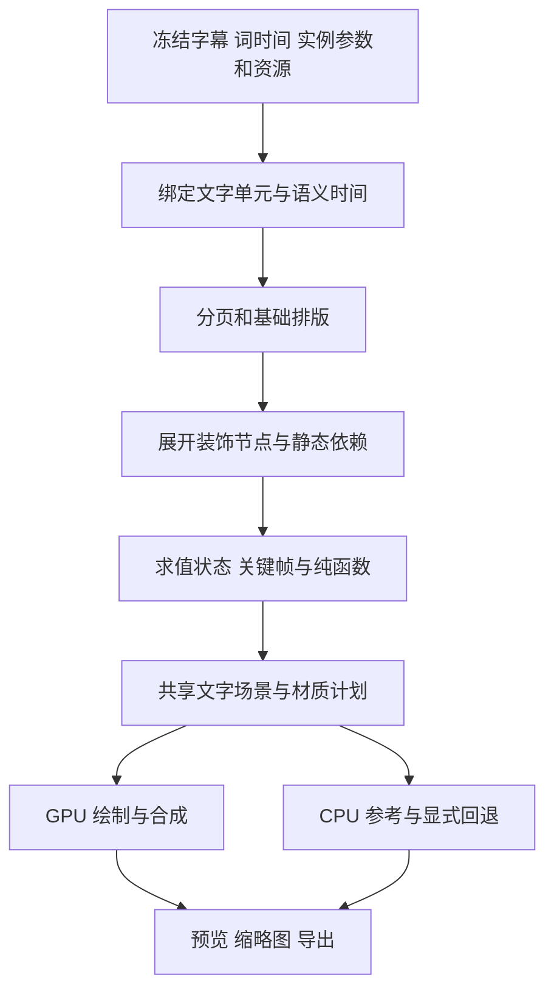

# BaoCut 动态字幕格式升级设计

状态：BaoCut v3 动态字幕目标设计，共享 CPU 基础执行档已实现，UI 待实施。本文保留完整能力目标，并整理成可直接指导实现的动画配方与材质分级；已生效的字段、预算及明确拒绝的扩展以[视频格式 §5.6](../../spec/video-format-spec.md#56-layoutprofile样式与导出)为准。本文中标注“目标”的字段、内置函数和材质尚未进入格式规范，不能当作已生效合同引用。

为了支持更丰富的动态字幕，将字幕表现升级为 **参数化文字场景、文字单元选择器、语义时钟、属性动画、纯函数表达式和材质效果栈**。字幕内容与词时间继续由已有文档负责，表现模型负责它们如何布局、运动和绘制。

动态函数采用带类型、只读上下文、无副作用的表达式树，由共享 Rust 核心求值。关键帧描述设计好的动作，表达式描述随时间、词状态、序号或布局变化的关系。两者共用属性、单位与合成规则，预览和导出使用同一实现。

## 目录

- [1. 目标与现有基础](#1-目标与现有基础)
- [2. 内容、模板与实例](#2-内容模板与实例)
- [3. 参数化文字场景](#3-参数化文字场景)
- [4. 文字单元与选择器](#4-文字单元与选择器)
- [5. 布局与几何合同](#5-布局与几何合同)
- [6. 语义时钟与朗读状态](#6-语义时钟与朗读状态)
- [7. 属性动画与合成](#7-属性动画与合成)
- [8. 动态函数与表达式](#8-动态函数与表达式)
- [9. 涂装、装饰与材质](#9-涂装装饰与材质)
- [10. 求值管线与缓存](#10-求值管线与缓存)
- [11. 动画配方目录](#11-动画配方目录)
- [12. 格式示例](#12-格式示例)
- [13. 现有格式衔接与模块调整](#13-现有格式衔接与模块调整)
- [14. 验收与实施顺序](#14-验收与实施顺序)
- [15. 待评审事项](#15-待评审事项)

## 1. 目标与现有基础

### 1.1 目标效果

| 表现 | 所需格式能力 |
| --- | --- |
| 念到某个词时变色、放大、抬升或扫色 | 词时间、朗读状态、词级样式与属性动画 |
| 每页若干词，逐词弹入，整页滑出 | 分页、页时钟、词时钟、错开与动画组合 |
| 当前词弹性超调入场、横向拉伸并真实放大字号 | 指数/三角函数表达式、按词字号重排、绘制期缩放 |
| 字幕逐字累积显现、羽化显现或带闪烁光标跟随末字 | 字素序号与页内序号、墨迹框、绑定装饰、取整/取模函数 |
| 每个词独立底框，关键词有下划线、底色或图标 | 按单元重复生成节点、字形包络绑定、标签选择器 |
| 字符波浪、交替旋转、带种子的抖动 | 单元索引、连续时间、纯函数表达式 |
| 多层文字、发光、纹理填字、移动扫光、运动模糊 | 多层场景、有序涂装、遮罩、材质参数动画与有界历史采样 |
| 图标或 emoji 跟随关键词，字幕改字后自动重新布局 | 稳定的词引用、装饰绑定、字体/图片资源和布局依赖 |
| 跨句交错排版、上一句退场时下一句进入 | 有界的多 cue 场景、独立语义时钟和确定性节点身份 |

字幕必须保持可编辑；换样式不改转录，改文本后重新求布局和动画。拖动播放头、保存重开及导出同一时刻，应得到相同的语义结果。低质量交互预览可单独定义，但不能作为精确预览的验收结果。

### 1.2 可复用能力与差距

| 已有基础 | 升级方向 |
| --- | --- |
| `baocut.caption/1`、源词引用、素材 occurrence 与时间映射 | 保留内容真相；增加稳定的显示单元与场景绑定 |
| 七维样式：字体、涂装、布局、当前词、动效、强调词和排版模式 | 继续作为简洁的编辑模型，编译到通用文字场景 |
| `MotionGraph`、关键帧、并行/串行、错开/重复、振荡/噪声 | 增加字幕语义时钟、选择器绑定和连续表达式通道 |
| `replace/add/multiply`、相对长度及类型化属性 | 统一字幕新属性的类型、单位、取值域、阶段与合成规则 |
| `frame-render → subtitle-render → render-raster` | 保留预览/导出的共享核心，增加场景编译与求值分支 |

当前 [MotionGraph](../../../crates/motion/src/graph.rs) 会把部分图操作展开为关键帧：曲线对象按不低于 60 fps 的网格采样；振荡/噪声则按既有分段线性波形的断点展开，能够保持该波形的既定语义。这两种情况不能混为“全部按 60 fps 近似”。新连续函数独立定义数值合同，旧配方保持原结果。

现有 [七维样式模型](caption-style-model-design.md) 是面向编辑的描述；[视频格式 §5.6](../../spec/video-format-spec.md#56-layoutprofile样式与导出) 中仍保留 Studio 和 Boxed 的实际落盘正文。本文增加通用场景正文，不把已有目标合同误写为已实现的新 schema。

### 1.3 表现分级与范围

动态字幕效果按实现依赖分为五级。分级决定一个效果归哪一组合同、在哪个阶段验收（§14.2），不是模板的字段。

| 分级 | 覆盖表现 | 主要依赖 | 当前范围 |
| --- | --- | --- | --- |
| glyph-motion 字形运动 | 弹入、滑入、缩放、错峰、累积显现、光标、整页慢推 | 单元时钟、属性动画、表达式、绑定装饰 | 基础执行档与 §8.2 内置函数已生效 |
| text-paint 文字涂装 | 渐变、描边、阴影、按词底框、关键词配色与字号 | 涂装栈、字形包络、标签与字号绑定 | 已生效 |
| texture-effects 纹理效果 | 高斯/级联发光、噪声色条、扫光、运动模糊、噪声位移、bloom、背景差值、残影克隆 | 材质节点、渲染层、有界历史采样、背景依赖 | 部分已生效；其余见 §9.5 |
| pixel-particles 像素实例 | 尘粒、碎裂、逐像素飘散 | 每像素实例化与噪声位移 | 暂缓，不列入阶段 A–E |
| derived-decoration 派生装饰 | emoji、贴纸、多层图片阴影的装饰字 | 显式实例数据、图片与图片序列资源 | 实例数据路径已生效；自动生成器只产出实例数据 |

分级越高，对渲染后端和预算的要求越强；低分级效果不得因为高分级能力缺失而被整体拒绝。预检按节点和材质逐项给出分级与缺失原因。

## 2. 内容、模板与实例

### 2.1 三层所有权

| 层 | 负责内容 | 不随换模板改变的事实 |
| --- | --- | --- |
| 字幕文档 | cue、显示文本、源词引用、文档时钟 | 原文、译文及真实词时间 |
| 场景模板 | 参数声明、布局、图层、选择器、动画、表达式和材质 | 不持有项目的具体朗读内容 |
| 字幕实例 | 模板参数覆盖、词标签、词显示范围、装饰绑定、seed、作用范围 | 引用当前字幕及其 occurrence |

继续使用 `CaptionItem.documentId/styleDocumentId/scopeItemIds`。拟增加 `caption-style` 文档正文 `baocut.caption-scene-style/1`，其中保存场景模板及共享参数；实例级覆盖拟放在 `CaptionItem.presentation`。场景模板自身使用独立的 `baocut.caption-scene/1`，既可内嵌，也可引用冻结的内容寻址产物。

```ts
// 目标 DTO 概要；Id、ArtifactRef 沿用 BaoCut 的身份与内容寻址规则。
interface CaptionSceneStyleBody {
  schema: 'baocut.caption-scene-style/1';
  scene: { kind: 'inline'; value: CaptionScene }
       | { kind: 'artifact'; ref: ArtifactRef };
  parameters: Record<string, ParameterValue>;
}

interface CaptionPresentation {
  parameters?: Record<string, ParameterValue>;
  cueOverrides?: CueOverride[];    // cueId，必要时带 occurrenceId
  wordTags?: Record<string, string[]>; // 稳定 wordId -> emphasis、hero 等标签
  decorations?: DecorationBinding[];
  seed: string;                   // 固定十六进制 uint64；创建时落盘
}

interface CueOverride {
  cueId: string;
  occurrenceId?: string | null;
  parameters: Record<string, ParameterValue>;
  wordTextProjection?: {
    textSha256: string;           // 当前 cue 显示文本的原始 UTF-8 字节摘要
    words: { wordId: string; start: number; end: number }[];
  } | null;
}

interface CaptionScene {
  schema: 'baocut.caption-scene/1';
  evaluationVersion: number;
  requiredCapabilities: string[];
  parameters: ParameterDefinition[];
  resources: SceneResource[];
  layout: CaptionLayout;
  speechState: SpeechStatePolicy;
  nodes: SceneNode[];
  selectors: UnitSelector[];
  paintStyleBindings?: PaintStyleBinding[]; // 缺省 []，空列表不写入序列化
  functions: PureFunctionDefinition[];
  animations: AnimationBinding[];
}
```

参数优先级为模板默认值 → 样式文档参数 → 实例参数 → 指定 cue/occurrence 参数。每一层只接受已声明的参数、类型与范围；不存在的参数不静默忽略。参数覆盖与节点属性动画是两个阶段，不能把所有对象递归深合并后猜含义。

模板声明的分页模式、参数默认值和候选资源都是默认值；分页可以由实例或准备阶段的程序化规则覆盖（§5.2），覆盖结果与自动选出的标签一样保存为实例数据，不在每帧重新推断。求值得到的绘制状态只是派生缓存，三层中任何一层都不保存它。
`caption-word-text-projection/1` 允许实例通过 `CueOverride.wordTextProjection` 将有效源词 ID 绑定到当前 cue 显示文本的 UTF-8 字节范围。它只提供显示成员关系，不改写字幕文档、源 speech 词文案或真实词时间，也不在 core 中执行大小写、语言或模板专属转换。范围是 `[start,end)`，由文本摘要约束；完整有序绑定、cue/occurrence 覆盖、静态文本与节点大小写的限制及预算统一见[视频格式 §5.6](../../spec/video-format-spec.md#56-layoutprofile样式与导出)。未提供投影时继续既有词文本匹配，不能静默猜测或用估算时间替代无效投影。

强调词和装饰是用户内容的注解，按稳定词 ID 绑定。改字、删词时失效的绑定作为问题报告，不自动挪到相同索引的其他词。自动生成的标签/emoji 先作为显式实例数据保存，再参与渲染；表达式不在画帧时调用分析服务。

所有内容引用在导出时冻结版本。只分享样式不会包含字幕文案；保存视频则保留字幕、样式及实例覆盖。双语仍是两份独立字幕文档，可共用模板但分别绑定文本、时间和参数；不假定原文与译文逐词对应。

### 2.2 与现有样式的关系

七维样式作为场景的高层编写方式：`typography` 编译为文字样式，`surface` 编译为涂装与底板，`layout` 编译为布局，`activeWord` 编译为状态绑定，`motion` 编译为动画，`emphasis` 编译为标签样式。预设只是这些声明的组合。

编译器保留来源字段映射和版本，方便面板继续编辑。自定义场景可能包含七维面板无法表达的结构；界面只修改有明确映射的字段，不能在保存时抹掉其余结构。编译产物是派生缓存，不与作者声明形成两份可独立修改的真相。

## 3. 参数化文字场景

基础节点类型为 `group`、`text`、`shape`、`image` 和 `repeat`；`caption-bound-label/1` 显式增加只用于重复装饰的 `label`。文字保留为一段可正确 shaping 的文本，通过单元属性控制各部分；不默认把每个字拆成互不相关的 text 节点。

| 节点能力 | 合同 |
| --- | --- |
| 身份与层级 | 节点有稳定 ID；父子树无环；同父节点按 `zIndex`，相同值按声明顺序绘制 |
| 文本绑定 | 可绑定当前 cue、明确的槽位或模板静态文字；双语槽位必须显式绑定 |
| 重复节点 | `repeat` 按指定 cue/page/line/word/grapheme 集合展开装饰，不执行任意循环 |
| 局部几何 | 明确 anchor、pivot、布局位置与绘制变换；父变换沿树组合 |
| 分组效果 | group 可隔离到离屏表面，再作用 opacity、clip、mask、effect 和 blend |
| 关联几何 | 装饰可绑定同一场景内某个单元的基础框或绘制后框，依赖必须无环 |

重复节点的运行身份由模板节点 ID、cue ID、occurrence ID 和单元 ID 组成，不用全局计数器或创建顺序。透明度变化只改变可见性，不销毁再重建节点。模板复制文字以产生残影时共享字形与布局，独立应用绘制属性。

绑定文字装饰 `label` 只作为 Repeat 的直接子节点，携带固定单行内容和自己的字体样式，复用所选源单元的时钟与几何。它先计算字号、再整形并提供自己的 advance/字体高度/最大单 glyph ink 度量，最后计算绘制 pose；自身度量不能反向决定字号，连同函数间接依赖一起校验。不会为标签创建独立的字幕页或命中对象，也不从输入文本自动生成装饰。完整字段、预算和边界见视频格式 §5.6。

节点拓扑、repeat 集合、资源选择与字体集合在准备阶段确定，不能由逐帧表达式无限增长。显示一个不同图标可在已声明的有限资源集合中选择，不允许表达式拼接新的资源地址。

默认一个场景实例对应一个 cue。跨句场景使用明确的 `scope: 'sequence-window'`，声明前后时间窗口和最大 cue 数；窗口按当前绝对时刻选取，不依赖播放历史。超过资源预算报错，不截掉部分句子。现有跨句排版的迁移须单独验证其布局和时序。

## 4. 文字单元与选择器

### 4.1 单元表

| 单元 | 定义 |
| --- | --- |
| `cue` | 字幕内容的一条 cue，在某个 occurrence 中的一次显示 |
| `page` | 根据分页规则从 cue 中派生的连续显示集合 |
| `line` | 页面经基础排版得到的视觉行 |
| `word` | 有词引用时使用保留词组；否则是显示分词单元，时间来源另行标记 |
| `grapheme` | 用户感知字符单元；与 Unicode 码点、UTF-16 单元及字形不等同 |

单元表保存源词 ID、显示文本范围、逻辑/视觉顺序、父单元、时间来源及 shaping cluster 映射。自动补显示间距、大小写转换等显示变换必须同步这张映射表，不修改源文稿。

现有 CJK 拆字路径应保留原词组与显示子字的双向关系，按模板的单元声明选择，不能把 `word` 和 `grapheme` 当同一概念。RTL 的 logical order 与 visual order 明确区分；索引从零开始，范围使用半开区间。

选择器可按单元类型、ID/标签、索引范围、奇偶、当前/已读/未读状态组合 `all/any/not`。选择器只读确定的单元表，禁止任意代码或隐式文本正则执行。`index`、`count` 默认指所属父单元中的完整集合；选中集合另提供 `selectedIndex/selectedCount`，防止当前词切换导致错开序号跳变。

### 4.2 字形完整性

字形整形先于绘制级单元动画。多个 grapheme 组成同一 shaping cluster 时，不能直接截断字形；动画组以 cluster 为最小几何单位，默认按 cluster 中首个逻辑 grapheme 选取驱动值，其他字符共用结果。该归并规则进入格式版本及诊断。

确需更细的拉丁连字动画，可显式关闭可选 ligature 后重新排版；不能拆开必要的组合字形或 emoji ZWJ。语言未知时采用通用 Unicode 分段与 shaping，不能回退到按字节切分。阿拉伯文、印度文字与组合重音须有专门夹具。

### 4.3 关键词与标签

关键词只来自显式标签：用户手动标记，或离线生成器按规则选出后写入 `wordTags`。典型生成规则是每行按实例 seed 选出固定数量、互不相邻的词；规则的输入是冻结的行成员与 seed，输出是词 ID 集合，渲染只读取该集合。改字后重新运行生成器并重新保存，表达式不在画帧时选词。

关键词样式分解为相互独立的维度，各自走已有合同，不新增一个“关键词模式”总开关：

| 维度 | 合同 | 阶段 |
| --- | --- | --- |
| `supersize` | 标签选择器上的静态字号倍率，经字号绑定进入真实重排（§5.4） | 基础布局 |
| `capitalization: none / upper / mixed` | 显示变换，同步单元映射表，不改源文稿（§4.1） | 基础布局 |
| `isolation: none / line / page` | 分页约束，关键词独占一行或一页（§5.2） | 分页 |
| 颜色表 `sequential / shuffled` | 按关键词在 cue 内的全局序号取模选色；shuffled 用固定 seed 做无放回置换（§8.2） | 状态样式 |
| 底框 `expand / offset / roundness / underline` | 独立装饰节点读取字形包络（§9.2） | 装饰布局 |

同一个词可以同时带多个标签；标签样式按 §7.2 的层次合成，标签之间按声明顺序取优先级。标签不改变词身份，也不把词拆成新的单元。

## 5. 布局与几何合同

style.lineBox 可显式选择真实字形 face 的字体上下包络，带独立 em 下限与 typographic/probe fallback 策略。排版宽度仍来自同一 shaping，行高提升到至少该包络，基线按最大 ascent 放置；静态、固定页与逐采样重排共用模型，避免相同字号因进入重排路径而使用不同文字中心。默认路径不变。生效字段、度量口径与预算见[视频格式 §5.6](../../spec/video-format-spec.md#56-layoutprofile样式与导出)。

### 5.1 显式单位与坐标

所有长度声明单位或基准，禁止同一数值在不同字段隐式代表像素、百分比或字号。复用 [相对长度模型](../../../crates/motion/src/relative_value.rs) 的 `value/basis/offset`：画布宽高/短边、自身基础框、父基础框等；增加 `fontEm` 时明确绑定到哪个文字节点的基础字号。不同基准的长度相加先在同一布局上下文中解析，再运算。

场景画布坐标原点在左上，x 向右、y 向下；长度解析到输出像素，角度使用弧度，缩放与 opacity 是无量纲数。每个框带坐标空间标识，跨父节点引用必须显式变换。文字基线、advance 框、字形 ink 框和含效果的绘制框分别提供，底板默认围绕 advance/layout 框，而非模糊后的外扩区域。

### 5.2 分页与换行

`CaptionLayout` 声明行宽、最大行数、每页最大单元数、手动换行处理、对齐、行距、安全区和溢出策略。先按逻辑单元与硬换行构造候选页，再用实际字体排版；超出行数时在合法单元边界拆页。默认模式中手动换行是硬边界，不为了凑满每页词数抹掉。

超长单词的处理为显式 `overflow: 'wrap-grapheme' | 'clip' | 'shrink' | 'error'`；`shrink` 必须有最小字号，不能无限缩小。确定布局后生成稳定 page/line ID；词、页和行的身份在同一输入下可重算。

每页三个词与每行三个词是不同规则，分别由 `maxUnitsPerPage` 与 `maxUnitsPerLine` 表达。基础布局按整页的全部文字计算；尚未显示的词默认保留位置。需要随显现重新排版的效果必须单独声明，不能由 opacity 推断。

当前 `caption-word-line-layout/1` 提供显式固定分组模式：`pagination.wordLinePattern` 循环声明每页各行的词数，`lastPageRule` 可以一次性调整末页之前的行配额。该模式由词分组决定页和行，宽度只负责溢出检查；不会自动增加页或改变行成员。只有显示shape字符串会折叠空白，原始正文、词身份与全段字素索引保持不变。它与默认保留硬换行的模式明确区分，适用于需要稳定词行节奏的动画。尾页规则、守恒限制、字节映射与溢出合同见视频格式 §5.6。

`caption-line-unit-quota/1` 落地了按宽度换行页的 `maxUnitsPerLine`：一行最多取该数量的词，下一个词会超出行宽时仍提前换行，页继续按 `maxLines` 收行。它和 `wordLinePattern` 的区别是行成员仍随字号与宽度变化，所以页成员也随之变化；逐采样排版与字号重排按同一配额折行。同时声明 `maxUnitsPerPage` 时先按页配额切块，再在块内按行配额折行。

末尾只剩一个词时，有的动画让它并进前一行，而不是单独占一行或一页。`lastPageRule` 是“末页出现某行词数就替换倒数第二页配额再重排”，会改动前一页的分组，表达不了这种只挪一个词的规则。`caption-word-line-tail-join/1` 的 `tailWordRule: 'join-previous-line'` 只处理未填满的末页：最后一行只有一个词时并入前一行，已填满的页不变。两条规则互斥。

有的动画按「还剩几个词」决定下一页取几个词、排成几行：例如剩 3 个词时排成三行各一词，剩 2 个词时一行两词。这种计划不是固定循环，`wordLinePattern` 和 `lastPageRule` 都表达不了。`caption-remaining-word-page-plan/1` 的 `remainingWordPagePlans` 把它写成显式查表：第 i 项是剩余 i 个词时下一页的行计划，超过表长用最后一项。源动画如果用随机数决定页长，由导入器按剩余词数预先算好整张表，渲染期不跑随机，结果只取决于词数。第 i 项最多 i 个词，保证每页取满、不截断。

固定行的词数是计划好的，但文字宽度取决于字体和内容，一行可能比文本框还宽。常见的排版引擎会让这样的行在框内自动续行，行的成员和动画分组都不变。`caption-fixed-line-wrap/1` 的 `fixedLineOverflow: 'wrap'` 把这种行为写成显式选项：固定行先冻结成员，排版时超宽才按宽度续行。续出来的显示行按普通行参与 line 单元和行时钟，这是为了不在单个 line 单元里放多条基线；依赖「一行一条显示行」的字号绑定、字体绑定和页窗口与它互斥。

另一种常见做法正好相反：固定行永远不续行，而是把每页各行缩放到同样宽，形成「每行一样宽」的块状字幕，短行字大、长行字小。`caption-fixed-line-fit/1` 的 `fixedLineFit` 把它写成显式规则：按基础字号量出各行宽，每行放大到最宽行；末行太短时只放大有限倍数，避免一个词的末行大得突兀；行距随页内最大缩放收紧。缩放只取决于本页文字的测量结果，所以放在核心排版里，而不是用逐单元字号绑定表达——后者读不到行宽，会形成依赖环。

还有一类滚动字幕：每页只有一行，新行出现后旧行不立刻消失，而是留在原位，直到它的槽位被后来的行占用，所以屏幕上同时叠着两三行。`caption-line-slots/1` 的 `lineSlots: {count, pitch}` 把它写成显式规则：页序号 k 对 count 取余得到行槽，槽位 0 在最上方；页的显示窗口从它自己的开始延到第 k+count 页开始，没有这一页就延到最后一页结束，所以任何时刻最多 count 行同时可见。槽间距是这一行行盒高度的倍数，换字号或字体时槽距跟着变，不需要另写位移表达式。它不是 `pageWindow` 的扩展：`pageWindow` 只在相邻词之间重新分配间隙，并要求页窗口互不重叠，行槽在它排布完之后才延长窗口，重叠只在这里产生。滞留的旧行也不跨过 `pageWindow` 判定的静默间隙，那段时间什么都不画。渲染时所有可见页的单元拼成同一棵单元序列，仍然只有一个 Cue 单元，页序号、行序号等全局上下文与不用行槽时一致；因为多页同时可见，它要求每页恰好一行，并与其他会改变页成员或行数的分页字段互斥。

分页由模板声明的分页程序决定，程序只在准备阶段运行，输出稳定的 page/line 成员。候选模式按能力分别列出：

| 模式 | 说明 | 状态 |
| --- | --- | --- |
| `maxUnitsPerPage` / `maxUnitsPerLine` | 按单元数上限与宽度构造候选页 | 已生效 |
| `wordLinePattern` + `lastPageRule` | 循环声明每页各行词数，如 `[[1]]`、`[[3]]`、`[[2],[2]]`、`[[1],[1],[4]]` | 已生效 |
| `textLinePattern` | 每行字符数上限与每页行数，计数单位为 Unicode scalar 或 extended grapheme，如每行 11 字、每页 3 行 | 已生效 |
| 字符计数组 | 按显式 scalar 区间与附着规则分组，如 `{2,2}`、`{2,2,2}` 字符组 | 已生效（`caption-scalar-cluster-layout/1`） |
| `tailWordRule` | 未填满末页只剩一个尾词时并入前一行 | 已生效（`caption-word-line-tail-join/1`） |
| `remainingWordPagePlans` | 按剩余词数查表决定下一页的行计划 | 已生效（`caption-remaining-word-page-plan/1`） |
| `fixedLineOverflow` / `fixedLineFit` | 固定行超宽时续行，或把一页各行缩放到同宽 | 已生效（`caption-fixed-line-wrap/1`、`caption-fixed-line-fit/1`） |
| `lineSlots` | 单行页滚动叠放在 2–4 个行槽上：第 k 页占槽位 k mod count，窗口延到第 k+count 页开始 | 已生效（`caption-line-slots/1`；限每页一行的 `wordLinePattern`，可与 `isolation`、`pageTags`、`pageWindow` 同用，与其他分页字段互斥） |
| `patternSelect` | 从候选模式集合中按 cue 词数区间或实例 seed 选取一个模式；选择结果冻结进实例数据并进入诊断 | 已生效（`caption-pattern-select/1`；准备阶段由冻结的词数或实例 seed 与 cue id 确定，不写回实例，以 `CAPTION_PATTERN_SELECTED` 报告） |
| 关键词隔离 | 在候选页构造前，为带 `isolation` 标签的词插入硬边界：`line` 独占一行，`page` 独占一页 | 已生效（`caption-keyword-isolation/1`；限固定词行模式，不与 `lastPageRule` 同用） |
| 标签段隔离 | 按词是否带标签把词分成连续同状态段，只在状态变化处断开：`line` 显示行不跨段，`page` 页不跨段且页配额逐段重数 | 已生效（`caption-tag-run-isolation/1`；限按宽度换行的默认分页，折行规则在冻结布局、逐采样布局和单元字号重排中相同） |

`patternSelect` 与关键词隔离不和 `wordPagePattern`、`maxUnitsPerLine`、尾词合并、剩余词查表、固定行续行或缩放、页标签同用：这些规则都会改写固定行的成员或几何，与选模式、插边界叠加时的先后顺序还没有定义，校验直接拒绝。隔离只在词边界插入边界，不拆词；隔离后仍超出每页上限时按溢出策略处理，不静默放宽上限。选择器的 `index/count` 按最终成员计算，错开序号不因隔离产生空位。

### 5.3 布局属性和绘制属性

| 属性 | 阶段 | 是否影响换行 |
| --- | --- | --- |
| 字体、基础字号、字距、行宽、文本内容 | 基础布局 | 是 |
| 绘制位移、缩放、旋转、opacity、单元颜色 | 绘制求值 | 否 |
| 装饰框 padding、跟随位置、底板尺寸 | 装饰布局/绘制 | 不反向改变文字布局 |
| 描边、阴影、模糊、纹理 | 涂装与合成 | 扩大绘制范围，但不默认改变换行 |

`layoutEvaluation: 'static'`：基础布局可读取静态参数和文本，但不能读取时间、活动词状态或自身排版结果。当前词放大默认使用 `transform.scale`，不挤动邻词；要真实挤动邻词时用逐单元字号（§5.4）。静态关键词字号可以影响布局，朗读时的强调缩放只影响绘制。

已实现的 `layoutEvaluation: 'per-sample'` 允许白名单布局属性随时间求值；它们只能读取时间、参数和稳定单元元数据，不能读取本次生成的行、页、bounds 或依赖这些结果的状态。先求动态布局参数，再布局一次，不做猜测性的迭代求解；基础分页成员保持准备阶段的结果，动态溢出按显式策略处理。当前执行档支持 error/visible 两种动态溢出策略，字段与预算见视频格式 §5.6。

### 5.4 单元字体与真实重排

可选 `fontSource={sha256,faceIndex}`（`caption-font-source/1`）为Text/Label及fontStyleBindings显式绑定字体资源face。同family/weight的不同字节不再靠全局注册先后选择；仅查询已注入Binary字体，来源或collection index缺失在排版前拒绝。导出保留冻结原文件的摘要与collection index；单face抽取仍用于旧family路径，原完整文件通过source-only资源库传入，未引用资源不扩展普通family或fallback候选；引用face的缺字仍走引擎fallback。来源注册及摘要缓存有明确数量／字节预算，批量注册失败保持旧状态。内部解析先于整形、lineBox与Label，复用同一TextEngine和缓存；旧族名匹配不变，未覆盖字符仍走既有确定性fallback，不将来源绑定误称无fallback。引用保留原family作为展示提示，运行时使用独立内部族；不硬编码任何外部来源族或参数。布局派生程序经共享测量入口传同一fontSource，独立装饰字体单独指定，避免主文字已绑定而测量仍按普通族选错版本。完整类型、cap和顺序规则见视频格式规范。

`fontStyleBindings` 将静态字体族、字重和斜体patch绑定到page/line/word选择器，与现有`fontSizeBindings`合成为完整的字体runs，再整体整形一行。绑定保留语义成员，更新真实字形、基线、行宽和邻词位置，不用scale冒充字号。保留源空白覆盖，空白行也测量选中face；无原始标签不推断关键词。声明的所有潜在face进入导出字体清点，包含未活跃分支；具体cap、预算和类型合同见视频格式规范。它与独立文本装饰层、每层位置变换分工明确，不自动重建外部运行时生成的层。

`wordPagePattern` 以循环词数计划先固定页成员，页内继续按宽度折行，超长词可以占多行；`maxLines` 只决定溢出处理，不再把该页拆成更多页。这使页分组和行排版成为两个独立决定，逐采样字号重排保留原页成员与时间。能力、预算和互斥字段见视频格式的 `caption-word-page-layout/1`。

`fontSizeBindings` 原本只用于 `wordLinePattern`/`textLinePattern` 固定行；按宽度换行的页声明 `caption-unit-font-reflow/1` 后也可使用。页成员仍在准备阶段按基础字号冻结，每次采样只按实际字号对当前页重新折行，行数可以变化，但不把词移到别的页，因此当前词放大可以把邻词挤到下一行再回来；超过 `maxLines` 或单词超宽按声明的 `overflow` 处理。它不改变分页成员，与 §14 第 2 项不同。重新折行后的行在采样之间没有稳定身份，所以与 line 选择器、按行内序号筛选的 word 选择器、行时钟和 `caption-page-window/1` 同用时拒绝；字号选择仍在基础行上求值。行身份合同另行评审。

## 6. 语义时钟与朗读状态

### 6.1 时钟映射

持久时间沿用 [视频格式 §2](../../spec/video-format-spec.md#2-时间模型) 的明确时间域与精确采样规则。模板中的时长和偏移用 `{ ticks, timescale }`；输出帧时间经序列→素材 occurrence→cue 映射后，得到语义时钟。表达式内提供以秒为单位的只读数值，不能通过逐帧累加 `deltaTime` 推进。

`ClockRef` 包含目标单元、原点 `start/end`、有理数 offset 和持续时间来源：`fixed` 或 `unit-span`。提供未钳位的 `elapsedSeconds`、`progress` 和单独的 `clampedProgress`；事件区间默认 `[start, end)`。零时长不能做除法，作为一步跳变处理。

cue 时间来自投影结果。word 保留真实词时间；page/line 的 speech span 是其成员词时间的包络，display span 则由展示策略决定。二者分开命名。默认页面从该页首词开始展示到下一页首词开始，最后一页到 cue 结束；cue 开始到首词前是否显示首个页面由 `leadingGap` 声明。跨页出入场可显式重叠，不篡改词时间。

动画相对 `word.start` 触发与相对 `page.displayStart + index × stagger` 触发是两个合同，不能互换。退场可绑定 `cue.end/page.displayEnd` 并使用负 offset。变速、裁切或重复使用素材后重新计算映射；显示窗口外裁剪动画，不拉伸全部动画去强行填满 cue。

格式内唯一的时间载体是 `{ ticks, timescale }`。导入外部动画资产时遇到的毫秒词时间、整数微秒关键帧、浮点秒曲线或秒级 seek 位置，一律在导入阶段按有理数精确换算到该载体（毫秒取 timescale 1000，微秒取 1000000，浮点秒按声明精度转为有理数并记录换算精度）；表达式和关键帧内部不再区分这些来源，也不混用。

`ClockRef` 的尾端策略 `tail: 'none' | 'clamp' | 'repeat'`（已生效，`caption-clock-tail/1`）：`none` 让 `progress` 超过 1 并交给 `fill` 决定轨道是否参与；`clamp` 取 `min(elapsed, duration)`；`repeat` 取 `elapsed mod duration`，周期右端点属于下一周期。`tail` 决定数值，`fill` 决定参与，两者不能互相替代。既有 `clampedProgress` 等价于 `tail: clamp`；关键帧 key 位于 `[0,1]`，`clamp` 在关键帧上取值与 `none` 相同，只表明意图。`repeat` 与 `clock.repeat` 互斥，零周期拒绝；精确合同见[视频格式 §5.6](../../spec/video-format-spec.md#56-layoutprofile样式与导出)。

页边界有两种合同：默认所有页使用 `[start, end)`；固定分页可通过显示窗口（§6.3）选择“第一页 `[start, end]`、其余页 `(start, end]`”，即共享边界属于前页。同一场景只能选一种，页切换帧的验收用例必须覆盖所选规则（§14.1）。

### 6.2 当前词和缺少词时间

`speechState` 明确指定 `gapPolicy: 'none' | 'hold-previous'` 与 `tailPolicy: 'none' | 'hold-last'`。真实活动词先从满足 `start <= t < end` 的词中选择；重叠时取开始最晚者，再按逻辑索引较大者决定。空隙和尾段按对应策略处理；首词之前没有活动词。active 优先于 read，其他词依其结束/开始时间判 read/unread；被重叠规则排除但仍在发音区间的词记为 read，保证三态唯一。

同一时间零时长词没有活动区间，但可在该时刻触发一次确定的动画边界；不得在每次 seek 时积累事件计数。页切换先确定所属页面，再在其显示集合中求状态。

活动词状态原本只能经 word 选择器和 `stateStyles` 改变活动词自身；“每换一个词，整句做一次短促的横向拉伸”这类效果要由 cue/page/line 读取“当前词进行到哪了”。`caption-active-word-context/1` 给同一文字节点的所有单元及其装饰提供 `unit.activeWordAvailable`（bool）、`unit.activeWordIndexInPage`（scalar，当前页内零基序号）、`time.activeWordElapsedSeconds` 与 `time.activeWordDurationSeconds`（time）。活动词沿用上面的选择，只在当前页冻结成员内取；窗口是包含采样时刻、该词连续保持活动的区间，`hold-previous`/`hold-last` 保持的时段计入，终点不超过页的显示结束；被后开始的词重叠打断后又恢复的词开始新窗口。没有活动词时为 false/0。窗口只依赖冻结成员和词时间：布局绑定禁止读取，字号绑定可以读取。

活动词底框在换词时从上一个词滑到当前词，要求装饰知道上一个词在哪里。`caption-line-neighbor-context/1` 只给出同一视觉行内上一个词的布局矩形（`unit.previousWordInLine`、`layout.previousWordX/Y/Width/Height`），换行处没有邻居，底框直接出现在新词上；滑动时长与插值仍由场景表达式决定。跨行邻居和下一个词暂不开放，需要时以新版本扩展。

整行扫带从左到右扫过、字随扫带逐个显现时，判断一个字素是否已被扫到要知道它在本行内的相对位置。`layout.x` 是画布坐标，行起点随居中与换行变化，只靠字素序号比例又会让宽窄字形与扫带错位。`caption-line-box-context/1` 让行内各单元读取所属行的行框（`layout.lineBoxX/Y/Width/Height`），扫带宽度与显现阈值都由场景表达式按同一页进度计算，核心不内置“扫”这一动画。

有的动画按整页的行来排版：三行页里中间行放大，首行右缘对齐中间行、末行左缘对齐中间行，再把三行整体居中；四行页按每行宽度相对全页最宽行的比例左右交错；是否放大还取决于前两行的字数。这些规则要求每一行都能看到兄弟行，`lineBox` 只给出自己的行，`previousWord` 只给出同行的前一个词。`caption-page-line-context/1` 按页内行号开放当前页各行的行框和非空白字素数（`layout.pageLineBoxX/Width.<k>`、`unit.pageLineGraphemeCount.<k>`），对齐、交错和放大条件都由场景表达式计算，核心不内置这些排版规则。行号是字段路径里的静态数字，不引入数组或动态下标；字素数只依赖冻结的行成员，所以字号绑定也能用它。

有的动画按页上的样式编号决定效果：来源脚本排出每页各行的词数时，同时给每页记一个编号，读页时按编号选逐行字号、逐词还是整行淡入。不同编号可能排出同样的页形状（例如两种每行一词的三行页），只看页形状推不回编号。`caption-page-tag/1` 让固定词行计划的每页带一个整数标签（`pagination.pageTags`，与 `wordLinePattern` 同步循环），单元读 `unit.pageTag`，具体样式仍由场景表达式分支，核心不解释标签含义。标签与页形状放在同一份分页数据里，导入时按输入重放的页计划可以一并给出。

没有真实词时间时，`timingPolicy` 默认 `require-word-timing`：关闭朗读驱动并提示缺失依据，cue/line 的入退场仍可用。用户可显式选 `estimated`，按已声明的均分或字符权重生成显示时序；结果标记估算，只存在于派生层，不回写为转录词时间。译文不继承原文逐词时间来冒充目标语对齐。

词的 active/read/unread 三态保持唯一选择。另提供按区间判断的只读布尔 `word.inSpan`（`start <= t < end`，重叠词可同时为真）和 cue 级 `cue.speechPhase: 'before-first' | 'reading' | 'after-last'`（已生效，`caption-speech-phase/1`）。首词之前、末词之后需要特殊表现的效果读取 `speechPhase`，不把它们编码成第四个词状态。表达式类型系统没有枚举，三个取值分别以布尔 `cue.speechPhase.beforeFirst/reading/afterLast` 读取，词间空隙算 reading；缺少真实词时间时按上段 timingPolicy 处理：默认全为 false 并给出 `CAPTION_TIMING_UNAVAILABLE`，显式 estimated 以 `cue.speechPhase.estimated` 与 `unit.wordTimed=false` 标记估算。合同见[视频格式 §5.6](../../spec/video-format-spec.md#56-layoutprofile样式与导出)。

### 6.3 显示窗口与间隙分配

固定分页可声明显式页/行显示窗口（`caption-page-window/1`）：相邻真实词之间的间隙按阈值分为短/长两类，分别按 `before/after` 比例分配给后词和前词；`before + after = 1` 时两侧共用同一切点，避免浮点伪重叠。首词前、末词后保留原边界，不把首页提前到 cue 起点，也不把末页延到 cue 尾部。典型配置是短间隙对半分配、长间隙在阈值一秒处切换。

显示窗口与原始词时间分开保存；朗读状态、词时钟和装饰仍读原始时间，只有 page/line 显示时钟改用派生窗口。字号重排、装饰与历史采样不能改写窗口。入场提前量用 page 时钟的负 offset 表达；页窗口之外该页不绘制，不留残影。公式、输入约束与边界规则见[视频格式 §5.6](../../spec/video-format-spec.md#56-layoutprofile样式与导出)。

## 7. 属性动画与合成

### 7.1 统一动态值

```ts
type AnimatedValue<T> =
  | { kind: 'constant'; value: T }
  | { kind: 'keyframes'; clock: ClockRef; keys: Keyframe<T>[];
      interpolation: Interpolation; fill: FillPolicy }
  | { kind: 'expression'; expression: TypedExpression<T> };

interface AnimationBinding {
  id: string;
  target: { nodeId: string; selectorId?: string };
  property: string;
  value: AnimatedValue<unknown>;
  composite: 'replace' | 'add' | 'multiply';
  priority: number;
}
```

以上泛型是编写概要；JSON Schema 与 Rust 编译器按属性注册表验证实际类型。注册表声明 property ID、值类型、单位、求值阶段、允许的 composite、插值方式、范围和所需后端能力。未知属性拒绝；不能沿用渲染期忽略不存在效果通道的行为。

关键帧位置采用归一化 `at ∈ [0,1]`，由 clock 提供窗口；严格递增，重复位置拒绝。数值/向量支持线性与曲线插值，颜色按声明的颜色空间插值，bool/enum/resource 只支持阶跃。Bezier 明确是进度 easing 还是带时间/值手柄的属性曲线，两个类型分别编码；时间手柄需要求反函数，不能混同。

### 7.2 属性求值顺序

单个属性按以下顺序计算：节点基础值 → 静态标签样式 → 朗读状态样式 → 动画绑定。各层中先按 `priority`，相同时按声明顺序；最后按属性合同做 clamp/合法性校验。动画的 `replace` 使用绝对值，`add` 加增量，`multiply` 乘因子，颜色首版仅允许 replace 或明确的插值操作。

`fill.before/after` 取 `none/hold`。`none` 表示轨道不参与本次合成，`hold` 使用首/末关键帧；这避免为 replace 轨道定义含糊的“单位元”。组合动画的 priority 与 fill 必须在展开后保留。淡出动画乘 opacity 时不会被基础状态样式重新覆盖。

变换采用统一属性聚合后组装矩阵：`T(layout + offset) × T(pivot) × R × S × T(-pivot)`，再乘父矩阵。多个 scale 因子相乘，位移增量相加。需要不同旋转/缩放顺序时用显式父子 group 表达，不能依靠对象字段排列改变矩阵顺序。

### 7.3 动画组合与连续通道

复用 MotionGraph 的 parallel、sequence、delay、stagger、repeat 和 at。错开顺序可为逻辑、视觉、倒序、中心或带 seed 的置换；绑定时冻结展开结果。循环显式指定周期、次数或终点以及 loop/yoyo，终点 fill 统一处理，求值不依赖上一次执行。

目标是为 MotionProgram 增加可版本化的 `analytic` 通道，与既有 keyframe 通道共同参与采样；当前动态场景在 `caption-scene` 的统一动态值采样器中直接求值表达式，复用 motion 的曲线实现，尚未修改旧 MotionProgram 的 IR。表达式和连续波形不强制先降成每秒若干关键帧。旧程序继续原采样语义，新程序通过 `evaluationVersion` 锁定数值算法。

若某个消费者只能接收关键帧，派生采样产物必须包含区间、误差界、算法版本和足够的采样信息；台阶/断点显式保留。不能达到允许误差时拒绝。输出 fps 变化只改变采样时刻，不改变连续动画本身的频率与时长。

### 7.4 双透明通道与常值轨道

涂装透明度与节点透明度是两条独立通道：涂装项各自的 `opacity` 在涂装栈内作用于填充、描边或效果结果；节点或单元的 `opacity` 在隔离合成后整体相乘。两者相乘得到最终 alpha，不能合并成一个属性，也不能让其中一条通道覆盖另一条。按词底框的 alpha 属于底框节点，不与文字共用。

常值轨道在时间上仍然有意义：选择器按当前词状态选中不同单元，`{ kind: 'constant' }` 的值会随被选中单元变化而作用到不同目标。缓存键因此必须包含朗读状态和页身份，不能把常值轨道当作与时间无关的静态样式。

## 8. 动态函数与表达式

### 8.1 需要支持的函数能力

支持可复用的纯函数定义：有名称、带类型的参数、单个表达式返回值，可调用已注册内置函数或其他无环纯函数。存储 AST，不存可执行源码字符串。首版无赋值、递归、通用循环、外部 I/O 和任意 JavaScript/Lua 执行。

```ts
// 实际节点以 discriminated union 校验，以下列出核心形态。
type ExpressionNode =
  | { op: 'literal'; type: ValueType; value: unknown }
  | { op: 'read'; path: ContextPath }
  | { op: 'call'; function: string; args: ExpressionNode[] }
  | { op: 'if'; condition: ExpressionNode;
      then: ExpressionNode; else: ExpressionNode };

interface PureFunctionDefinition {
  id: string;
  arguments: { name: string; type: ValueType }[];
  returns: ValueType;
  body: ExpressionNode;
}
```

基本类型包含 scalar、bool、integer、length、time、angle、vec2、color 和受限 enum。维度检查先于执行：time 不能直接加 length，`sin` 接收 angle；频率与时间相乘须经显式操作得到相位。色值不是任意长度的数组。模板函数参数通过 `args.<name>` 读取，名称不能覆盖上下文或内置函数。

只读上下文提供：`time` 的语义时钟、`unit` 的稳定身份/索引/状态/标签、`layout` 的可访问框/基线、`canvas`、经校验的 `params` 及 `seed`。可访问字段由阶段和 target 决定；没有 word 目标却读取 `word.progress` 在编译时失败。邻词查询通过有限、显式的单元查询操作表达，不能任意遍历整份文稿。

已生效的只读上下文能力（文字序号、页序号、行时钟、cue 首次词与下一词边界、墨迹框等）统一列在 §13.3 的能力索引，字段与预算以视频格式 §5.6 为准。它们共同遵守：局部索引与全局索引分别命名；显示页窗口不替代词结束；估算时序与静态文字不冒充真实词绑定；缺少词时间时视觉时钟与朗读状态分开。

### 8.2 内置函数与数值规则

| 类别 | 首版操作 |
| --- | --- |
| 数学 | add/sub/mul/div、min/max、abs、clamp、smoothstep、sqrt、exp、pow、sin/cos、floor/ceil/round、mod/fract |
| 插值 | mix、颜色插值、命名 easing、带声明参数的连续曲线 |
| 字幕 | 状态判断、标签判断、稳定索引/总数、有限邻单元查询 |
| 几何 | 布局框读取、空间转换、padding 外扩、对齐/锚点计算 |
| 随机 | `random(seed, stableKey)`、带明确算法/晶格定义的 `noise(seed, x)` |

当前执行合同提供五个 scalar 参数的 `cubic-bezier(progress, x1, y1, x2, y2)`，复用 motion 求解器。它可与语义时钟及 `min/max` 组合，描述持续时间随当前单元时长变化的入场；progress 两端固定为 0/1，控制点 x 限 [0,1]，控制点 y 可超调。能力名为 `caption-bezier-expression/1`，参数和错误语义见视频格式 §5.6。

动画配方（§11）还需要以下内置函数，均须声明对应能力名；取模符号、列表参数与预算见视频格式 §5.6：

| 函数 | 合同 | 状态 |
| --- | --- | --- |
| `shuffle-index(index, count, seed)` | 固定 seed 的无放回置换，顺序取值用 `index mod count` 直接索引 | 已生效（`caption-permutation/1`） |
| `cubic-bezier(progress, x1, y1, x2, y2)` | 进度 easing，y 允许超调 | 已生效（`caption-bezier-expression/1`） |
| `exp(x)` | 自然指数，用于弹性衰减 | 已生效（`caption-exponential-expression/1`） |
| `floor / ceil` | 取整，返回 scalar | 已生效 |
| `round` | 四舍五入到最近整数，半数远离零 | 已生效（`caption-rounding-expression/1`） |
| `mod(a, b)`、`fract(x)` | 向下取整取模，结果与除数同号；`b` 为零返回诊断；用于闪烁、周期相位和量化时间 | 已生效（`caption-modular-expression/1`） |
| `pow(base, exponent)` | 仅 scalar，负底数非整数指数返回诊断；用于 `1 − (1 − q)^3` 一类缓出 | 已生效（`caption-power-expression/1`） |
| `pick(list, index)` | 从声明为参数的有限列表中按 `index mod count` 取值；列表元素类型统一，空列表拒绝 | 已生效（`caption-list-pick/1`） |

`pick` 与 `shuffle-index` 组合即“按序取值”或“按种子洗牌取值”：前者直接用语义序号取模，后者先置换再取模。两者的 seed 都来自实例 `seed` 与显式通道 ID，不读取时间。

random 对同 key 永远返回同值；时间噪声通过明确的连续坐标变化，不用“每画一帧抽一次”。key 由实例 seed、节点 ID、单元 ID 和通道 ID 组成，不因隐藏了邻词或换帧率而重排。函数算法及浮点/取整策略进入 evaluationVersion，native/WASM 使用同一实现和黄金值。

除零、非有限结果、越界索引和缺失的必填字段返回结构化错误；不得默认为 0 继续画。声明为可选的上下文字段有显式 optional 类型，作者使用类型正确的 `coalesce` 或条件表达式处理；coalesce 不吞掉执行错误。`if` 只求选中的分支，避免无效分支的除零污染合法输出。clamp 只用于属性声明的合法范围，不掩盖非法计算。

编译时校验 AST 深度、展开后的操作数、调用环和阶段依赖；运行时限制每帧操作数、节点数、材质 pass 和表面内存，超限可取消并报告。具体预算是可版本化的执行能力，不按一次普通效果的耗时无限放宽。

### 8.3 排版依赖必须可判定

表达式依赖图分为布局前、布局后和绘制后。静态布局不读自己的结果；装饰可以读文字基础框，不能让文字宽度又依赖该装饰框。绘制后跟随可读取已算完的目标变换框，但不能回写目标几何。属性动画不得读取任意其他属性的“最终值”形成反馈。

所有帧满足：`结果 = f(精确时间, 冻结内容, 模板, 参数, 资源, seed)`。效果如需拖尾，可用有界历史采样节点，对同一纯函数在指定过去时刻重复求值并合成；历史窗口与样本数固定，不能依赖曾播放过的帧。当前以 cue 级 feedback 材质实现，按固定 step 与有界样本重算前缀材质栈，具体合成和预算见视频格式 §5.6。

`caption-page-window/1` 为固定页/行成员提供显式显示时间分配：真实相邻词的短/长 gap 分别使用 before/after 比例，阈值和端点包含规则进入格式。显示窗口与原始词时间分开保存，跨页空白及共享边界有确定归属；字号重排、装饰与历史采样不能改写这些窗口。原始词/字素及首末词时间保持原义，非法或重叠输入拒绝，缺省场景不改变既有时钟。具体输入约束与数值公式见视频格式 §5.6。

`caption-unit-font-size/1` 将按 page/line/word 的字号选择放在富文本整形之前：先固定页与逻辑行源成员，再按当前语义时钟求有序字号区间，最后完整覆盖文字/空白并通过共享 rich shaping 重新计算几何。表达式不可读取本轮 layout/ink；绘制期缩放仍是另一条属性路径。新能力要求显式固定词行/文本计数布局，字号不会改变分页身份；行高采用字体 ascent/descent 与最大区间字号共同确定，repeat 与反馈采样复用同一结果。参数、覆盖顺序、Unicode 映射和预算详见视频格式 §5.6。此阶段不开放任意动态分页程序或依赖兄弟行最终位置的循环布局。

`caption-reference-geometry/1` 显式建立动画前参考墨迹：复用固定成员的rich shaping与静态字体patch，使用独立referenceValue字号，在编译计划中缓存真实glyph ink。动态字号和绘制矩阵随后消费当前几何与参考几何，避免用整体scale冒充逐字间距变化。无墨迹不使用advance回退；需要真实几何的作者可用显式precondition能力在所选单位执行时拒绝缺失值。稳定依赖、类型、惰性失败与预算合同见视频格式§5.6。


## 9. 涂装、装饰与材质

本节按执行位置分为涂装栈（文字局部空间）、装饰节点（读取布局后几何）、内置材质节点（页级离屏表面）和待实现的材质目标。每一项都声明取样对象、坐标空间、alpha 处理与预算；缺少后端能力时按 §9.3 末段的预检规则拒绝精确导出。

### 9.1 涂装栈

文字的 paint stack 是有序操作：填充（纯色/渐变/纹理）、描边、内阴影、投影、发光等。每项有稳定 ID，动画绑定到 ID 对应参数，不能靠删除一个效果后变化的数组下标识别。每项同时声明取样对象是原始 glyph mask 还是累计 layer result，避免多个效果顺序含糊。

`caption-paint-style-bindings/1` 提供场景级`paintStyleBindings`：每条`PaintStyleBinding`为`{id,nodeId,selectorId,style}`，`PaintStylePatch`为`{fill?: string, paints: PaintLayer[]}`。缺省为空列表，序列化省略空值。最多64条、绑定id唯一；目标限有显式非空基础paints且无旧stroke的Text，选择器限同一Text的静态word：all/tag/range/parity及and/or/not，递归禁止state。paints必填1–16层并整组替换，fill可省略但null拒绝；最后匹配绑定的整个patch胜出，不逐字段保留先前patch，省略fill沿用节点、父级及既有页填充的普通继承路径，不保留先前绑定fill或强制擦除页填充。静态fill之后再应用word stateStyles和fill动画；若某绑定stack不含node-fill（包括image.base中的node-fill），则该绑定不得声明fill，且该Text不得有任何stateStyles、fill property或fill动画；违反任一项即沿既有guard拒绝，基础stack也须通过原guard，不能静默忽略fill。字体与字号沿用已有绑定，advance、分页成员和词时钟不因涂装改变。

同一Text的基础与全部绑定stack共用最多16个layer ID，数组内顺序合并为偏序后作稳定拓扑排序，矛盾环在准备阶段拒绝。可选层的tie按首次声明顺序解决：基础stack先，再按绑定顺序扫描。层可增加或删除，同一ID也可替换完整PaintLayer定义。绘制按全局layer ID逐层进行；同一层内，相同完整PaintLayer定义的字形聚组，组按首字形首次出现顺序、组内按原字形顺序录制，不能按完整style分组画完整stack，以免较后组的描边或投影覆盖已画填充。共享纯函数`paint_style_order(scene: &Scene, node_id: &str) -> Result<Vec<String>>`提供统一层顺序。

同一个global layer ID内不同完整定义的group共同累计16Mi像素的blurred surface allowance，下一个layer ID才重置；绑定匹配中的binding、selector搜索与递归filter求值均计入共享操作budget。彩色字形只在全部轮廓涂装层之后绘制一次位图，不随stack长度重复；实际选中mask的彩色字形仍明确拒绝。

所有静态候选stack即使未活跃也进入能力和资源清点，复用已有paint数值、图片、渐变、coverage、mask与预算限制。同一个Text进入既有材质capture一次，不为不同词的涂装拆节点；无绑定保留旧执行、序列化和像素。完整类型、冲突检查、覆盖顺序与示例见[视频格式 §5.6](../../spec/video-format-spec.md#56-layoutprofile样式与导出)。

渐变的端点域与插值度量分开声明：linear paint 的 domain 选择基础行框、当前页框或每个字形自身的轮廓框（可按字号 em 外扩），space 选择文字局部像素投影或归一化 UV 投影。后者按逆宽高变换梯度协向量，再转换成共享光栅器端点，避免把非均匀缩放后的端点向量误当作同一颜色场。逐采样重排更新域，动画变换在其后应用；默认 local/line 保持旧行为。生效字段与拒绝范围见[视频格式 §5.6](../../spec/video-format-spec.md#56-layoutprofile样式与导出)。

图片涂装以显式 UV 矩阵和 glyph-em/glyph-normalized/line-normalized/page-normalized 空间取样冻结 PNG。图片与可选固色、渐变或当前填充 base 在同一次覆盖前合成，避免拆层重复抗锯齿；opacity 只调图片采样，compositeOpacity 独立调合成结果，默认1；普通涂装与 coverage/实例 alpha 一次量化，共同 opacity 的外扩/模糊 run 则隔离合成并模糊后一次应用整体 alpha，不能提前修改图片或 base 的 alpha；相位声明 cue-scalar-index，沿完整变换后文本的 Unicode scalar 逻辑起点计数，空白和分页不改变身份。此索引不等于字体物理 glyph 或未验证的来源 ordinal。能力、采样及 alpha 顺序、拒绝范围与帧预算以[视频格式 §5.6](../../spec/video-format-spec.md#56-layoutprofile样式与导出)为准；共享 CPU 录制有界位图后复用 GPU DrawBitmap 合成。

共享执行档允许 paint 通过 `coverage: {lo, hi}` 独立声明轮廓的线性区间重映射。先按相同 paint/opacity 的连续 run 合并不透明轮廓并模糊，再重映射覆盖率，最后应用 paint 和实例 alpha；不得把半透明颜色当作覆盖率输入。固色和不透明渐变复用同一机制，严格范围、预算、能力声明与当前后端边界见[视频格式 §5.6](../../spec/video-format-spec.md#56-layoutprofile样式与导出)。

文字涂装在局部空间完成，然后应用节点 clip/mask，再应用分组效果及 opacity/blend。需要别的顺序时增加隔离 group。效果扩展绘制 bounds，离屏画布按扩展范围分配，不能裁掉阴影和模糊。基线、布局框不随涂装自动改变。

### 9.2 装饰节点与按词底框

底板、下划线、图标和 emoji 使用独立装饰节点，可读词/行框。底板随当前词移动、缩放时，渐变应跟着底板本身走，而不是固定在画布或文字行上。`caption-shape-paint/1` 让 shape 用 `fillPaint` 填充（纯色或线性渐变），渐变坐标取 shape 实际绘制的矩形，宽高动画会把渐变一起拉伸，节点变换也一起作用。渐变替代普通 fill，二者不能同时声明。emoji 可以是明确字体字形或图片资源；字体 face、字节摘要、variation axes 和 fallback 集合均冻结。缺字或缺图片明确报错，不能因为系统上有另一份同名字体就改变结果。

`caption-glyph-envelope/1` 为按词底板提供两组独立几何：字体行度量与实际字形墨迹共同确定的不含 leading 垂直包络，以及按源 cluster 顺序取得的首/末字形墨迹横端点。端点不改写为 advance 或全部墨迹 union，也不因 RTL 自动交换；范围没有墨迹或没有唯一行时通过 bool 明确报告不可用。装饰、逐采样布局和反馈时刻共用这份布局后结果；现有 bounds/ink 合同保持不变，具体公式与预算见视频格式 §5.6。

`caption-page-envelope/1` 为页材质和装饰提供整页字体/字形垂直包络、实际最大字号和行数。它独立于词级墨迹范围；空白行仍有字体度量，混合字号取重排后的 size runs。普通单元、材质和反馈共享同一时刻的结果，布局前读取被拒绝；字段与预算合同见视频格式 §5.6。

按词底框的参考配方：`shape` 节点通过 `repeat` 按 word 展开，绑定该词的字形包络（首/末字形墨迹横端点与不含 leading 的垂直包络），把中心与半尺寸归一化到页框后再外扩 `expand`、平移 `offset`、设置 `roundness`；下划线是同一包络在基线下方的细条。底框的 alpha 与缩放独立于文字：`boxAlpha = min(2 × sin(π × p), 1)`，缩放走 `cubic-bezier(p, .2, .68, .76, 1.2)` 的超调曲线，`p` 为词时钟进度。底框不改变文字排版，也不参与文字的材质栈。

光标是绑定装饰的一个用法：`label` 携带固定的光标字符或图片，跟随当前页最后一个已显现字素的墨迹右端（竖排时跟随下端并旋转 90°），闪烁用 `floor(mod(p × n, 2))` 决定可见性，cue 尾段按 `cue.end` 负 offset 淡出。光标不创建命中对象，不改变行高。

### 9.3 内置材质节点

材质首版采用版本化内置节点及有类型的 uniform，把扫光、纹理滚动、噪声遮罩等开放为参数。保留 shader 材质扩展合同：资源摘要、入口、输入/输出格式、uniform 类型、纹理/采样器、pass 依赖、所需能力；实际支持的 shader 方言和后端在专门阶段验证后开放。纯函数算出的模糊半径或材质参数只有在渲染器支持时才有效。 当前 `caption-wave-displace/1` 提供 cue 级正弦逆向位移：幅度、波长、相位可纯函数求值，方向为 x/y，使用预乘双线性透明边界采样；具体范围、像素中心与预算合同见视频格式 §5.6。`caption-wave-context/1` 让这三个值改在指定文字节点当前页排版后求值：位移核不变，只把波长、幅度与相位原点绑到页矩形，适配“文字先渲染到按页尺寸加边距的离屏纹理，再按 UV 做正弦位移”这类源效果。

当前 `caption-gaussian-axis/1` 与 `caption-glow-cascade/1` 增加单文字子树的独立分量高斯和多尺度级联发光。二者显式绑定唯一 Text 的排版后页上下文；每个 pass 的采样距离以输入纹理 UV 定义，输出缩放按原画布有理比例向下取整，逐 pass 执行 gamma 与 UNORM8 量化。固定画布边界、normalize/replicate/transparent 行为、级联顺序和合成公式均按视频格式 §5.6，不与 box blur 混同。优化按任意 RGBA 分量非零的有效区域传播，实际采样工作与表面峰值都计入预算。可选 `glowTint` 以 `caption-glow-tint/1` 显式启用，使用同一文字节点排版后的页上下文；只在各级发光聚合及 clamp 后乘 RGB，再与原图合成，忽略 tint alpha 并保留发光 alpha。省略为白，旧文档不新增字段或求值成本，旧像素保持不变。

这些材质允许关联 RGBA8 的 RGB 大于 alpha，并通过显式发光位图及原始关联输出保留。透明宿主不能先解预乘再截断颜色，也不能把查看背景写进字幕测试数据；不支持的混合/输出格式返回诊断。此能力没有开放任意 shader 或多 Text 材质绑定。

颜色与 alpha 延续 [架构 §9.3](../../architecture/architecture-design.md#93-颜色与-alpha) 的合同。内部 pass 若需要别的精度/颜色空间必须显式声明转换；shader、CPU 和 GPU 路径不能各自隐式处理。需要 backdrop 的效果声明对背景子图的依赖，不能当作独立透明贴片缓存。

缺少某项能力时预检给出具体节点/属性/材质的原因，精确导出拒绝；预览可使用明确标记的简化模式。当前 `compositor` 已启用 retained scene 的 GPU 执行 feature，但动态场景材质与预览宿主尚未接入；丰富材质不能仅凭字段或 adapter 存在就标记为已支持。平台能力按 macOS、Windows 与 Web 分别验证。

共享材质增加 `noise-palette-mix`，以显式 `domain` 描述画布中局部UV范围，绑定冻结PNG色条，并在文字当前页上下文求值噪声phase和色条位置。固定有界噪声核保持输入alpha，只改变RGB；输出RGBA8后可接现有Gaussian/Glow材质。局部坐标与渲染参数由格式明确提供，不能自动以inkBounds或词advance代替；轴对齐domain不隐式跟随旋转。该能力不引入任意shader或脚本执行，完整系数、边界与预算见视频格式规范的“显式局部纹理的噪声色条混合”。

`caption-glow-color-matrix/1` 为 glow-cascade 增加可选静态 `glowColorMatrix`（行优先 9 个有限数）。它在聚合 clamp 和 glowTint 之后变换辉光 RGB，再 clamp 后与原图合成；不影响 alpha 或原图。省略/单位矩阵保持既有像素与序列化兼容，非法形状、null、非有限系数及乘法溢出拒绝。

`caption-glow-linear/1` 让 glow-cascade 表达线性域多级辉光：最多 8 级；`gammaChannels: rgba` 让每个 pass 和聚合对 alpha 也做 gamma 编解码；`aggregation: linear` 在解码域按静态 levelGains 做 `1−Π(1−wk×dk)` 聚合，再以 intensity 缩放、编码；可选 levelColor 在解码前用 `color×level.alpha` 替换各级 RGB；`original-over-screen` 把原图放在 screen 结果之上并以 `O.a²` 保留原图覆盖。省略这些字段时旧文档逐字节不变。GPU 材质计划暂不执行该能力，显式拒绝，由 CPU 光栅执行。

`angular-sample-blend` 对显式局部纹理domain执行固定60次逆向角采样，aspect与domain尺寸独立，angle遵守弧度单位。域外读取贡献透明零但不改变分母，随后用平均alpha在.6倍原图和均值之间混合。它保留独立RGBA、零角度的非恒等行为和共享预算，不能降级成节点旋转或高斯模糊；不引入任意shader或帧历史。格式细节见视频格式规范材质章节。

`gradient-smear` 提供 evolving 梯度噪声驱动的固定128次方向采样，显式声明局部domain、噪声尺寸、种子、伸缩、进度及UV纵向。它可以表达词长相关的拉伸拖影，保留冻结多层噪声与透明越界规则；不会把文字动画替换为整层淡入。上下文选择、静态与动态数值边界、独立RGBA以及工作预算按视频格式规范执行，预览和导出使用同一无历史核。

对于文字与装饰需要分别发光、遮罩或混合的效果，共享核心提供有序 `renderLayers`：每层选择明确根节点或有界图片序列，再执行独立材质栈。页面与词时钟仍由冻结的文字布局派生，材质不会改变其他层。关联 screen 输出保留到真实场景背景，不能提前拍成一张透明字幕图。图片序列采用摘要锁定与按需解码，固定噪声扫过属于受限内置材质；字段及预算见[视频格式 §5.6](../../spec/video-format-spec.md#56-layoutprofile样式与导出)。

`caption-gaussian-sampling/1` 将明确的整数输入 texel 子区域、分数输出 quad 和 tap 顺序接入同一排版后材质求值。UV 核距离按输入子区域计，边界不读取邻接像素；两个方向可使用不同的输入／输出域，保留中间纹理量化和最终输出网格。它不隐式推测字体紧框、纹理 padding 或宿主投影，导入侧须显式提供这些几何。

矩形重映射自身保留轴可分性，固定高斯核的工作量按两轴实际有效 texel 数求和后相乘，覆盖区域夹边、fractional quad 和 RGBA 非零支持；输出与扫描成本另计。空间距离场仍用保守估算。这样避免完整输出域的四读取上界错误拒绝稀疏输入，保持原像素、预算上限与分辨率。

`caption-affine-over/1` 增加两个独立 UV 采样矩阵和背景 opacity/RGB 衰减。两个采样读同一不可变前缀表面，按关联分量做 foreground-over-background，保持半透明边缘与发光；这与两次独立文字光栅化或沿路径平均不同。输入 ROI、输出域、采样边界及数值/预算合同见[格式规范](../../spec/video-format-spec.md)。当前实现落在共享 CPU 场景/导出/WASM 路径，GPU material-plan 返回明确未支持错误；有序 pass 图、独立 offscreen surface 分配及状态式来源重放仍需后续扩展。

`caption-gaussian-uv/1` 表达任意二维signed采样步长及UV空间sigma，使用明确input/output采样域，按中心、负向、正向的有序tap归一关联RGBA；RGBgain与alpha分离。现有affine-over的identity foreground/backgroundOpacity0可把前缀采样到指定整数子网格；后续gaussian-uv读取该网格并写回完整局部域，再按后续材质顺序合成。当前子网格仍须完全在已有画布表面内，不能假装已支持超画布localRT、任意pool或source native捕获。具体合同见[格式规范](../../spec/video-format-spec.md)。

`caption-layer-capture/1` 为层提供显式独立局部纹理，先在局部尺寸直接光栅化全局源，再执行材料，最后按原点贴回最终背景；源可以位于最终画布外。布局与时钟仍使用全局上下文，材料另读surface原点与尺寸。首版有界无历史组件链由CPU执行，GPU明确回退；整数矩形、支持范围与资源预算见视频格式§5.6。

### 9.4 显式仿射路径采样

`caption-affine-sample-blend/1` 为唯一 Text 的当前页提供显式归一化 UV 路径：输入 texel ROI、输出 quad、2–32 个六系数 scalar DynamicValue 矩阵、采样数量区间、端点距离区间和边界模式都由格式给出。每个像素按首末控制点的欧氏 UV 距离经 smoothstep 选择 2–256 个样本，沿等距控制点分段线性插值变换后的 UV，再等权平均独立 RGBA 分量；不求矩阵逆、不改为节点旋转、高斯或依赖过去画面的反馈。

域与所有矩阵系数必须在排版后有有效值，不使用单位矩阵或当前 pose 猜测缺失数据；输入 ROI 不读相邻 texel，输出域可裁到画布。normalize、transparent、replicate 沿用明确 UV 边界，保留 RGB 大于 alpha 的关联颜色，并计入控制点、读取、输出及共享表面预算。完整公式、范围和失败合同见[视频格式 §5.6](../../spec/video-format-spec.md#56-layoutprofile样式与导出)。共享录制生成已求值的渲染器无关命令；GPU 原生路径采用补偿参数／判定和有运行时整数舍入屏障的运算，保留临界低位。不能可靠复现的内部密度阈值在提交前明确回退，不生成 CPU 密度贴图；CPU f64 reference 保留。源操作、后端和实际场景覆盖分别验收，不据单一材质支持宣称全库 GPU 化。

### 9.5 待实现材质目标

以下材质来自目标效果拆解，尚未进入格式规范。每项先给出纯函数或材质合同，再映射到已有能力；没有映射的列为新材质，须单独立项、声明能力名并通过 §14.1 的验证点。

| 目标效果 | 合同 | 映射 |
| --- | --- | --- |
| 运动模糊 | 对同一纯函数在 `t − i × step` 的过去时刻重新求值并等权或按核合成；参考配置为 11 个样本、步长 25 ms，再接一次独立分量高斯，sigma 为采样跨度的固定比例 | 已生效：`caption-feedback/1` 的有界历史采样加 `caption-feedback-mean/1` 的等权平均聚合（`composite:"mean"`，仅统计 cue 内样本），再接 `caption-gaussian-axis/1`；默认衰减 source-over 不变；自定义核仍为目标；不引入帧历史 |
| 量化噪声相位 | 噪声相位取 `floor(t × rate)`，UV 抖动取 `floor(t × rate2)`，使噪声按固定频率跳变而不是逐帧连续 | 已有 `noise(seed, x)` 与 `floor`；rate 为静态参数 |
| 噪声 UV 位移 | `uv' = uv + (n − 0.5) × strength × aspect`，其中 `n = (noise + brightness − 0.5) × contrast × 10 + 0.5`；预乘双线性透明边界采样 | 已生效：`caption-noise-displace/1`（噪声源为 noise-palette-mix 的固定 v1 核，仅 CPU，GPU 材质计划显式拒绝）；`caption-wave-displace/1` 只覆盖正弦位移 |
| 扫描扭曲 | 文字背后按页重复的底板与文字一起被重采样；一次重采样内：两路分形梯度噪声移动采样点，再让条纹内的内容围绕 domain 中心列横向拉伸，最后叠加扫描线明暗与整体增益；条纹以像素给出核心半高、衰减与门限 | 已生效：`caption-scan-warp/1`（噪声复用 gradient-smear 的固定核，仅 CPU，GPU 材质计划显式拒绝） |
| 径向畸变 | 文字（及随文字的底板）在 domain 内做一次径向重采样：采样点沿中心向外按 `1+strength·dot(p,p)` 缩放（正值桶形、负值枕形），再平移 shift 个 domain 高/宽；动态量可随页进度变化 | 已生效：`caption-radial-warp/1`（仅 CPU，GPU 材质计划显式拒绝） |
| 多尺度辉光 | 可分离高斯多级级联，采样距离按 720 基准归一到实际画布 | 已生效：`caption-glow-cascade/1`、`caption-glow-linear/1` |
| bloom 置底 | 以 0.3 倍降采样做 9 权重核的可分离模糊，纵向权重乘 1.1，再按 `original + bloom × (1 − original.a)` 合成到原图之下 | 先验证 `caption-glow-linear/1` 的 `original-over-screen` 是否等价；不等价则作为 glow 的新聚合模式 |
| 背景差值负片 | `abs(text.rgb − video.rgb × text.a)`，alpha 取文字 alpha | 新材质，必须声明背景子图依赖（§9.3 末段），不能缓存成透明贴片 |
| 残影克隆 | 同一文字子树输出多层，各层独立位移/透明度/混合（Normal 或 Add）并可用遮罩裁切 | 复用 `caption-render-layers/1` 的多层与 blend；已生效：`caption-layer-add/1` 的 `blend:"add"`（关联 RGBA 四分量 `S+D` 钳制，直接作用于真实背景） |
| 多层图片阴影装饰字 | 固定层数的 PNG 偏移叠加（例如十几层）构成火焰或立体质感 | 复用涂装栈多项投影与 `caption-image-paint/1`；层数进入预算 |
| 像素实例飘散 | 每个像素作为一个实例，按噪声位移、`smoothstep` 遮罩与 `opacity = a^0.3` 显现，非物理积分 | pixel-particles 分级，暂缓；不以材质伪装 |

火焰、辉光等材质输出允许 RGB 大于 alpha 的关联颜色，按 §9.3 的宿主合同保留。背景依赖的材质在缩略图和导出中必须拿到同一时刻的真实背景，预览若用占位背景须标记为简化模式。

### 9.6 GPU 源涂装与隔离

共享 DrawOp source 保留原始顺序、fill rule 与 stroke 的 width/cap/join/miter；只上传缓存字形资源，不上传 CPU 合成的逐帧场景。源 `PushLayer/PopLayer` 的 Normal 隔离先在独立 RGBA8 表面合成子绘制，再一次性应用 opacity，支持嵌套；给每个子绘制分别乘组 opacity 不等价。源组深度最多32，每帧最多128线性涂装与128隔离复合，表面与保守逐字形读取量进入既有 GPU 总预算，在任何提交前拒绝超限。

源 `prepare_for_canvas` 使用1倍设备覆盖，常规 stroke 先按原始局部 path 与原 tf 的 resolution scale 生成整体 outline，再映射到完整设备坐标。曲线细分本身对 f32 平移敏感，不能先移到小块坐标再扫描。缓存 miss 时用原 viewport 大小的 A8 scratch 扫描单字形，保留 CPU 画布裁切与大画幅扫描网格，再裁出有界字形小块上传；不在 CPU 合成整张动画场景。normal coverage 键包含原几何、fill/stroke 参数、完整 tf 与 viewport，Solid／Linear 颜色和 alpha 仍由 GPU 求值并复用 coverage。变换／viewport 变化可能触发准备和上传，不能无条件去掉整数平移。无 viewport 的 `prepare` 保留原局部4倍掩膜及 transform/color uniform 策略，不代表设备扫描等价。

Solid paint 先浮点预乘再量化字节；Linear 先量化直通道再按 CPU lowp 规则预乘；随后应用覆盖率。最多32色标的 pad Linear 保留原路径局部域、独立 alpha、非均匀色标及重复色标硬边，近退化／单色回退按 Solid 顺序。源组采用CPU Pattern的highp路径，在children合成后保留f32 opacity，到目的RGBA8写入时量化；普通 retained scene 与最终关联材质合成的精度政策不变。GPU destination blending 仍可能有字节舍入差异，须以全 RGBA 实测判定，不能用准入成功替代像素或原版保真验收。

零宽及CPU判定为设备细线的正宽stroke在Caption GPU执行器中保留原scanner有序覆盖事件。预合成RGBA tile无法表达每次blit针对当前destination的字节舍入；不能用透明tile对照通过证明非零背景等价。独立coverage fork只增加scanner事件出口，原registry CPU渲染器不变；完整tf、cap曲线细分、裁切及8191扫描grid顺序均保留。设备ROI存储每像素offset/count与有序u8覆盖率，geometry键不含paint或width调制。GPU读取当前源组destination后逐事件执行：原浮点paint不透明时用Source/Lerp的一次组合舍入，其余用lowp预乘SourceOver。不得从量化后alpha255猜测原paint不透明。计算到独立ROI纹理后覆盖回源组，无同一pass读写同纹理，无CPU场景合成或整帧上传；不要求storage buffer或可选GPU特性。

ROI最多2046×2046，每程序最多262144 spans、4 Mi事件、每像素65536事件，每帧最多128stroke操作。事件缓存、整帧唯一活跃程序与准备临时分别有64 MiB预算；GPU估算包含缓存保留、整帧唯一事件纹理和每操作ROI，不能以LRU移除替代encoder存活资源计费。原retained缓存／CPU scratch各64 MiB不变，`prepared_masks`统计字形，`prepared_strokes`统计新事件程序。超限在提交前明确拒绝，不降采样。独立`prepare_for_canvas`保留RGBA hairline兼容准备，它本身不提供destination-aware执行。Radial、非Normal源混合、clip/matte及未接入操作保留明确回退。该backend变化不增加模板字段、不改变CPU出图，GPU执行／像素对照与原版保真仍分别验收。

## 10. 求值管线与缓存



准备阶段处理 schema/类型/能力检查、参数合并、单元表、分页、字体、基础布局、拓扑和依赖图；按需要缓存编译结果。帧阶段由精确时刻求状态、动态值和 pass，所有目标由同一份 Rust 逻辑执行。启用逐采样布局后，在帧阶段按 §5.3 重算受影响布局，再求其后的装饰和动画。

缓存分为模板编译、内容绑定、布局、字形、材质和最终帧。键包含模板/求值版本、文档和实例 revision、occurrence、真实/估算词时间、参数、字体/资源摘要、画布、颜色及执行后端；最终帧再加时间和背景依赖。改词时间可能改变页面/行时钟，不能只清掉动画缓存；改字或字体须重建受影响布局。

命中框和编辑手柄从同次布局及变换派生；屏幕显示比例只影响查看，不改变模板的画布计算。缩略图按声明的画布/时间采样再缩放，不能用缩略图容器宽度重新决定字幕换行。

后台准备与逐帧计算支持取消、内存预算和版本标记，迟到帧不覆盖新 revision。导出使用冻结输入，预览的系统字体或资源变更不得渗入正在进行的导出。任意 seek、乱序渲染和多 Worker 分片应产生相同结果。

### 10.1 GPU 执行与跨平台性能合同

整条字幕绘制链路以 GPU 为目标后端。CPU 保留文本整形、分页、逐采样布局、语义时钟、表达式求值和资源解码；文字/彩色字形的绘制、逐字变换、底板与装饰、遮罩、材质 pass、反馈采样与最终背景合成在 GPU 上执行。稳定字形允许首次在 CPU 生成 mask 并上传图集，不能逐帧在 CPU 光栅整张字幕后只让 GPU 贴图。

共享 Rust 核心产出 retained scene 与已求值的材质参数。宿主只负责设备、媒体纹理、画布和提交，不复制排版、时间或动画规则。预览与导出复用相同的计划和着色器；常规预览没有逐帧 GPU→CPU 像素回读，测试和确实需要 CPU 像素的编码接口显式调用回读。

| 平台 | 目标后端 | 验收要求 |
| --- | --- | --- |
| macOS | Metal | Apple GPU；仍支持的 Intel/AMD 机型分别实测 |
| Windows | DX12；可用时 Vulkan 兜底 | NVIDIA、AMD、Intel；集显与独显分别记录 |
| Linux | Vulkan | 驱动与软件 adapter 区分，不能把软件光栅宣称为硬件加速 |
| Web / Electron | WebGPU；WebGL2 兼容路径 | 实际浏览器编译、画面与设备丢失恢复，不以 WASM 编译通过代替 |

后端选择按能力和实际创建结果进行，不硬编码显卡品牌白名单。不默认要求 FP16、compute shader、storage texture 或浮点过滤等可选能力；增强路径需分别探测。纹理尺寸、采样格式、绑定数、uniform 容量和精度不足时给出结构化原因，使用经过验证的等效算法或明确回退 CPU，不能删掉效果、改变字体、画布尺寸或播放时间。

图集、序列纹理、管线和中间目标复用；按最后使用时刻淘汰，并分别限制驻留与峰值临时内存。预算按会话汇总，不能为每个模板各申请一个无限缓存。设备丢失后停止旧设备提交，失效全部 GPU 句柄，从冻结 CPU 资源恢复；旧 revision 的迟到提交不得覆盖新输入。精确导出遵守固定质量，交互预览的可选降质必须显式标记。

性能验收同时记录 CPU 准备/提交时间、GPU 完成时间、实际显示帧间隔 P50/P95/P99、长帧、上传字节、回读字节、缓存命中与显存预算。测试 720p/1080p/4K、单字幕及多个同时可见字幕，区分冷启动、热帧、改字、seek、resize 与显存压力；不能只看 requestAnimationFrame 或提交 FPS。帧率目标基于设备和场景预算，不能承诺所有显卡、任意数量与复杂度都没有开销。

实施按执行合同分批接通：retained 字形/矢量/纹理与基础合成 → 动态场景计划适配 → 完整材质图 → Web 与原生宿主接入 → 设备矩阵及压力验收。每批记录真实支持范围，未接通的模板继续明确回退；当前进度见 [`compositor`](../../../crates/compositor/README.md)。

## 11. 动画配方目录

本节把目标效果写成可直接落到格式的配方：每条给出驱动单元与时钟、数值合同（以纯函数 AST 的调用链表达）、所需能力和验收点。常数是参考值，由模板参数承载，不是格式默认值。`p` 为所述时钟的进度，`t` 为该时钟的 `elapsedSeconds`，`D` 为时长，`N` 为所属集合的单元总数，`i` 为零基索引。

| 配方 | 单元与时钟 | 数值合同 | 所需能力 | 验收点 |
| --- | --- | --- | --- | --- |
| 弹性超调入场 | word，`word.start`，固定 D | `scale = 1 + exp(−7p) × sin((p − 0.075) × 2π / 0.3)`，`p` 经 `tail: clamp`；`f(0) = 0`、`f(1) ≈ 1`，超过 D 后由 fill 固定为 1 | `exp`、`sin`、`cubic-bezier` 可选 | t=0 为 0；峰值超调帧；超过 D 稳定为 1 |
| 随时长缩放 | word，`word.start`，`unit-span` | `scale = min(0.8 + 1.5 × p × D, 1)` | `min`、`mul` | 短词与长词在相同绝对时间处缩放一致 |
| 朗读词横向拉伸 | word，active 状态样式 + 关键帧 | `scaleX = (k(t) / 100 − 1) / 3.5 + 1`，`k` 为关键帧曲线；字号倍率 1.5 走字号绑定 | `caption-unit-font-size/1`、状态样式 | 邻词随真实字号重排；拉伸不改行宽 |
| 透明度阶梯 | word，三态 | `alpha = 0`（unread）/ `p`（active）/ `1`（read）；变体 `min(2p, 1)`、`clamp(1.5p)` | 状态样式、`clamp` | 词边界前后帧；重叠词 |
| 滑入 | word 或 line，`word.start` | `offset = −4 × fontEm × (1 − cubicOut(p))`，沿书写主轴；竖排时切换到 y 轴 | `fontEm` 基准、`cubic-bezier`；书写方向上下文为目标 | 横/竖排各一组夹具 |
| 累积显字 | grapheme（含空白），所属 word 的 `word.start` 时钟 | `opacity = if(lt(time.elapsedSeconds, 0), 0, 1)` | `caption-text-context/1` | 空白字素编号稳定；seek 到词中间 |
| 羽化显现 | grapheme，page 时钟 | `a_i = 0.85 × i / N`；`opacity = smoothstep(a_i, a_i + 0.15, p)` | `pageTextIndex/pageTextCount`、`smoothstep` | 页首页尾字素；页切换帧 |
| 光标跟随 | label 绑定末已显字素 | 位置读墨迹右端；可见性 `floor(mod(p × n, 2))`；尾段按 `cue.end − offset` 淡出 | `caption-bound-label/1`、`caption-ink-context/1`、`caption-modular-expression/1` | 竖排旋转；cue 尾淡出帧 |
| 按词底框 | shape 按 word 重复，`word.start` | `boxAlpha = min(2 × sin(π × p), 1)`；`scale = cubic-bezier(p, .2, .68, .76, 1.2)` | `caption-glyph-envelope/1`、`cubic-bezier` | 紧框不随绘制缩放改变排版 |
| 逐字错峰 | grapheme，page 时钟 | `start_i = (1 − 0.4) × i / N`；`q = clamp((p − start_i) / 0.4, 0, 1)` 驱动位移与 alpha | `pageTextIndex/pageTextCount` | 首末字素；N=1 退化 |
| 按词延迟段 | word，page 时钟 | 每词从参数列表取 `(startFrame, dur)`：`q = clamp((p × total − startFrame) / dur, 0, 1)`；`alpha = 1 − (1 − q)^3`，y 由曲线 | `caption-list-pick/1`、`caption-power-expression/1`、`cubic-bezier` | 段表长度与词数不符时诊断 |
| 多行重排 | line，静态 | 按 `lineIndex` 选字号倍率与锚点，经字号绑定真实重排 | `caption-unit-context/1`、`caption-unit-font-size/1` | 行数变化后身份稳定 |
| 整页慢推 | page，`page.displayStart` | `scale = 0.9 + 0.06 × t`，`tail: clamp` 到页窗口 | `caption-page-window/1` 可选 | 页外不绘制；共享边界归属 |
| 字符波浪 | grapheme，连续时间 | `offsetY = amplitude × sin(phase(t) + i × phaseStep)` | `sin`、typed phase | 任意帧率同相位；opacity 为零的字符仍编号 |
| 关键词配色 | word 标签，静态 | `color = pick(palette, shuffle-index(k, K, seed))` 或 `pick(palette, k)`，`k` 为关键词全局序号 | `caption-permutation/1`、`caption-list-pick/1` | 改字后同 seed 结果稳定 |

配方之间的组合遵守 §7.2 的层次和 §7.3 的组合规则：位移相加、缩放相乘、alpha 相乘。任何配方都不得读取上一帧或自己的最终值；需要拖尾的改用 §9.5 的有界历史采样。

## 12. 格式示例

### 12.1 每页三个词，当前词变黄并弹入

以下是拟议 `CaptionScene` 中可组合的字段片段，不是现有可直接加载的文档。`caption` 为文字节点，`words` 为它的 word 选择器；基础颜色为白色。示例通过关键帧完成弹入，不需要自定义函数。

```json
{
  "layout": {
    "pagination": { "unit": "word", "maxUnitsPerPage": 3 },
    "layoutEvaluation": "static"
  },
  "speechState": {
    "gapPolicy": "hold-previous",
    "tailPolicy": "hold-last",
    "timingPolicy": "require-word-timing"
  },
  "nodes": [{
    "id": "caption",
    "type": "text",
    "text": { "source": "cue" },
    "style": { "fill": "#FFFFFF" },
    "stateStyles": {
      "unit": "word",
      "active": { "fill": "#FFE600" },
      "read": { "fill": "#FFFFFF" },
      "unread": { "fill": "#FFFFFF" }
    }
  }],
  "selectors": [{ "id": "words", "nodeId": "caption", "unit": "word" }],
  "animations": [{
    "id": "word-pop",
    "target": { "nodeId": "caption", "selectorId": "words" },
    "property": "transform.scale",
    "composite": "multiply",
    "priority": 0,
    "value": {
      "kind": "keyframes",
      "clock": {
        "unit": "word", "origin": "start",
        "duration": { "kind": "fixed", "ticks": 180, "timescale": 1000 }
      },
      "interpolation": "linear",
      "fill": { "before": "none", "after": "none" },
      "keys": [
        { "at": 0, "value": 0.85 },
        { "at": 0.45, "value": 1.18 },
        { "at": 1, "value": 1 }
      ]
    }
  }]
}
```

示例省略资源、字体和其余布局字段，正式文档仍须补全并校验。短词连续弹入允许重叠；缩放绕各词的基础框中心，不重新换行。

### 12.2 字符波浪与随词底框

字符波浪的数学表达为 `offsetY = amplitude × sin(phase(time) + index × phaseStep)`。存储时用 AST 依次调用 typed phase、add、sin 和 mul；amplitude 是 length，phaseStep 是 angle，frequency 的单位明确。index 采用完整逻辑 grapheme 集合，opacity 为零的字符仍参与编号。

底框 width 读取 `word.layoutBounds.width + 2 × padding`，位置锚到该框；文字先布局，再展开 shape。框跟随当前词的绘制缩放时，绑定绘制后框；需要底框保持原大小时绑定基础框。两种都能表示，且不会反向修改文字排版。

### 12.3 关键词与 emoji

实例把词 ID 标记为 `hero`，模板用标签选择器改变静态样式，并为每个 hero 生成一个 image/text 装饰节点。装饰读取词框中心，通过 `word.start` 时钟做位移、缩放和淡入。换一段文案后依靠新的显式词绑定重新计算，素材选择和标签不会在渲染循环里随机生成。

## 13. 现有格式衔接与模块调整

### 13.1 版本与回退

新增场景正文，不改变 `baocut.caption/1` 的内容语义。旧 Studio/Boxed 项目继续原有 lowering 与渲染路径；把既有预设编译到新场景前，对每份预设运行旧/新黄金帧测试，只有通过才切换默认编译路径。升级后保存保留模板和编译器版本，不强制迁移所有历史项目。

`schema`、`evaluationVersion`、材质版本和资源摘要独立演进。较旧程序遇到不支持的版本/能力，保留文档并报告不支持渲染；不丢字段后另存为似乎成功的新文档。预设刷新只影响用户选择升级的实例。

结构化诊断至少包括：`CAPTION_SCENE_SCHEMA_UNSUPPORTED`、`CAPTION_PROPERTY_UNSUPPORTED`、`CAPTION_EXPRESSION_TYPE`、`CAPTION_DEPENDENCY_CYCLE`、`CAPTION_TIMING_UNAVAILABLE`、`CAPTION_RESOURCE_MISSING`、`CAPTION_CAPABILITY_UNAVAILABLE` 和 `CAPTION_BUDGET_EXCEEDED`。问题带节点/属性/表达式位置，UI 与导出预检消费同一结果。

### 13.2 模块职责

| 位置 | 计划调整 |
| --- | --- |
| `packages/protocol`、`crates/video-model` | 新正文和实例字段的验证、版本及诊断合同 |
| `crates/subtitle-render` | 文字单元、分页、选择器、场景编译与标签/状态绑定；复用现有字幕和跨句能力 |
| `crates/motion` | 字幕层传入已解析时钟/目标；增加类型化表达式与 analytic 通道，保持通用运动层不依赖字幕文档 |
| `crates/render-raster` | 属性/涂装/材质执行、字形和离屏合成；共同维护确定性数值与颜色合同 |
| `crates/frame-render` | 新样式分支、实例生命周期、依赖失效、支持检查和命中框 |
| `bindings/preview-wasm`、原生导出 | 同计划、同资源与同求值版本；分别验证构建和输出 |
| Runtime、资源存储及冻结导出入口 | 资源解析、冻结、任务取消和能力预检 |
| 原型与 `packages/ui` | 七维参数编辑及高级场景能力的可解释呈现，不在 UI 实现表达式求值 |

字幕场景继续走共享 Rust 核心。若表达式实现需要独立 crate，再按稳定领域边界拆出；不提前建立通用脚本平台。UI 调整遵守 [原型先行与多端同步](../../development-workflow.md#3-多端同步)，后台格式与求值可以先实施。

同时审计 `frame-render` 当前按共享样式分组的行为：同 style ID 不足以合并有不同参数、语言、seed 或 occurrence 的场景。公共模板编译可以共享，实例绑定、时钟和最终帧缓存必须隔离。

### 13.3 已生效能力索引

下表列出视频格式 §5.6 当前可声明的全部能力、用途与本文对应章节；字段、预算与拒绝范围以规范为准，本文不重复。

| 能力族 | 能力 | 用途 | 章节 |
| --- | --- | --- | --- |
| 场景与表达式 | `caption-scene/1`、`caption-expressions/1`、`caption-function-dag/1`、`caption-unit-animation/1`、`caption-permutation/1`、`caption-bezier-expression/1`、`caption-exponential-expression/1`、`caption-rounding-expression/1`、`caption-modular-expression/1`、`caption-power-expression/1`、`caption-list-pick/1`、`caption-clock-tail/1` | 场景正文、typed AST、无环纯函数、按单元动画、置换、easing、指数、取整、取模、幂、列表参数取值与关键帧时钟尾端策略 | §3、§6.1、§7、§8 |
| 装饰 | `caption-bound-label/1` | Repeat 直接子节点的固定单行装饰，复用源单元时钟与几何 | §3、§9.2 |
| 字体 | `caption-font-line-box/1`、`caption-font-source/1`、`caption-font-hinting/1`、`caption-font-shaping/1`、`caption-text-transform/1` | 行框包络、按摘要绑定 face、hinting/shaping 选项、显示变换 | §4.1、§5、§5.4 |
| 布局 | `caption-word-line-layout/1`、`caption-text-line-layout/1`、`caption-pattern-select/1`、`caption-keyword-isolation/1`、`caption-tag-run-isolation/1`、`caption-line-slots/1`、`caption-scalar-cluster-layout/1`、`caption-layout-per-sample/1`、`caption-page-window/1`、`caption-unit-font-size/1`、`caption-unit-font-style/1` | 固定词行/字行分页、按词数或 seed 选择分页模式、关键词隔离与标签段隔离、单行页滚动行槽、字符计数组、逐采样重排、显示窗口、按单元字号与字体样式 | §4.3、§5.2、§5.3、§5.4、§6.3 |
| 只读上下文 | `caption-text-context/1`、`caption-unit-context/1`、`caption-cue-unit-context/1`、`caption-cue-word-context/1`、`caption-speech-phase/1`、`caption-first-page-context/1`、`caption-ink-context/1`、`caption-glyph-envelope/1`、`caption-page-envelope/1` | 全文/页内字素序号、页与行时钟、全 cue 词行序号、首次词与下一词边界、cue 朗读阶段与词区间布尔、固定第一页成员、字形墨迹框、按词与整页包络 | §6.2、§8.1、§9.2 |
| 涂装 | `caption-paint-stack/1`、`caption-paint-effects/1`、`caption-paint-coverage/1`、`caption-gradient-space/1`、`caption-gradient-glyph/1`、`caption-image-png/1`、`caption-image-paint/1`、`caption-image-phase-float32/1`、`caption-image-sequence/1` | 有序涂装项、效果外扩、覆盖率重映射、渐变域与空间、图片涂装与相位、图片序列 | §9.1、§9.3 |
| 材质 | `caption-blur/1`、`caption-gaussian-axis/1`、`caption-gaussian-uv/1`、`caption-gaussian-spacing-ramp/1`、`caption-gaussian-sampling/1`、`caption-glow-cascade/1`、`caption-glow-linear/1`、`caption-glow-tint/1`、`caption-glow-color-matrix/1`、`caption-feedback/1`、`caption-feedback-mean/1`、`caption-wave-displace/1`、`caption-wave-context/1`、`caption-noise-displace/1`、`caption-scan-warp/1`、`caption-radial-warp/1`、`caption-soft-band/1`、`caption-noise-palette-mix/1`、`caption-noisy-sweep/1`、`caption-angular-sample-blend/1`、`caption-affine-sample-blend/1`、`caption-affine-over/1`、`caption-gradient-smear/1`、`caption-render-layers/1`、`caption-layer-add/1` | 模糊与高斯族、辉光族、有界历史采样与等权平均、正弦与噪声位移、遮罩、噪声与扫光、采样混合、仿射前景/背景、独立渲染层与加法混合 | §9.3、§9.4 |

## 14. 验收与实施顺序

### 14.1 验收矩阵

| 维度 | 必须覆盖的行为 |
| --- | --- |
| 格式与类型 | 常量/关键帧/表达式等价；未知字段策略、类型错误、单位混用、非法曲线和版本拒绝 |
| 时间 | cue/page/line/word 起止、空隙和重叠、零时长、负 offset、词边界前后及循环终点 |
| 语义 | 有/无真实词时间、明确估算、删词/剪辑/变速/重复 occurrence、原文/译文分离 |
| 文本 | 中文、日文、韩文、拉丁连字、组合重音、RTL、印度文字、泰文、ZWJ emoji 及未知语言 |
| 布局 | 三词分页、硬换行、超长词、未读词占位、放大不重排、装饰框和阴影外扩 |
| 动画 | 组合顺序、fill、priority、错开索引稳定、纯函数/噪声重复性、属性 clamp 与错误 |
| 图形 | 填充/描边/阴影顺序、遮罩、纹理、透明边缘、背景依赖及缺后端诊断 |
| 随机访问 | 从头播放、直接 seek、倒序、乱序和分片渲染在同一时刻一致 |
| 跨端 | native/WASM 计划与数值黄金值一致；精确预览、缩略图和导出同资源同结果 |
| 编辑 | 改字/参数/词时间、撤销、保存重开、便携重开、缓存失效及旧帧丢弃 |

既有 [native/WASM 帧一致性测试](../../../crates/frame-render/tests/parity.rs) 扩展新场景夹具；CPU 同配置保留逐字节判定，GPU 路径单独记录计划一致与实际像素误差，不以同计划替代像素验证。新能力不得自动更新旧黄金帧来掩盖回归。

帧率覆盖 24/25/30/60 及 30000/1001，尺寸覆盖竖屏、横屏与方形；动画周期按秒稳定。测试轮廓、透明边缘、字幕 ROI 和事件帧，不能只比较全屏均值。连续函数验证输出帧之间的随机时刻，避免仅在采样网格上看似正确。

性能报告记录准备/字体与材质编译耗时、热帧 P50/P95、seek 延迟、实例/节点规模和峰值内存。1080p、30 fps 的整帧目标预算是 33.3 ms，字幕预算根据实际媒体合成开销分配；复杂场景超预算要给出证据，不能默默降低效果、精度或字幕帧率。

动画配方与材质另有固定验证点，每条配方至少覆盖：`t = 0` 的初值；页共享边界两侧各一帧；超调峰值帧；页窗口之外无残留像素；同一时刻重复 seek、正向与反向 seek 结果逐字节一致；至少两种输出尺寸下归一化几何一致。有状态实现（如“帧序号为 0 时重置”）在反向 seek 和分片渲染下必然失败，这是坚持 `结果 = f(精确时间, …)` 的直接理由，验收用例保留该反例。

### 14.2 实施阶段

| 阶段 | 交付范围 | 完成门 |
| --- | --- | --- |
| A 格式与语义基础 | 三层模型、schema、属性表、单元表、时钟、选择器和错误合同 | 三词分页/当前词效果的静态编译和边界用例通过 |
| B 共享动态渲染 | 场景节点、装饰、关键帧、合成和朗读状态 | 真实预览/导出完整闭环，seek 与旧字幕回归通过 |
| C 纯函数与连续通道 | typed AST、纯函数定义、analytic、确定性随机和预算 | 波浪、噪声和布局绑定跨帧率、native/WASM 一致 |
| D 丰富图形 | 多层涂装、纹理、材质 pass、能力预检 | 透明/混合/后端一致性与复杂场景性能通过 |
| E 编辑与预设 | 七维编译映射、参数编辑、模板版本、实例覆盖 | 原型确认后同步 Electron/Web；编辑撤销和保存重开通过 |
| F 扩展能力 | 逐采样布局、有界历史采样、必要的高级材质 | 单独能力版本和预算，独立验收后开放 |

阶段 A–C 构成动态字幕格式的基础；材质和高级布局按明确能力逐步开放，不因基础能出帧就标记所有节点可用。跨句基础能力可复用，但纳入新场景模型时须逐项回归。

落地时同步视频格式 §3.8/§5.6、架构 §9、命令诊断与验收矩阵；新功能已实现后再把目标合同改为生效合同。当前格式、表达式和共享 CPU 场景分支已接入；PNG 图片与冻结资源引用、有序填充/描边、线性渐变、cue 级模糊/独立分量高斯/级联发光/波纹位移/反馈材质、逐采样布局、页级活动词时钟和按宽度换行页的逐单元字号重排已接入；场景 artifact 引用、任意 shader、节点级材质与高级场景编辑继续按后续阶段实施。

表现分级（§1.3）与阶段的对应：glyph-motion 与 text-paint 归阶段 B–C，texture-effects 归阶段 D 与 F，derived-decoration 的实例数据路径归阶段 E、自动生成器单独立项，pixel-particles 暂缓且不占用阶段 F 的预算。

## 15. 待评审事项

1. 确认采用 `caption-scene` 表达通用场景、`caption-scene-style` 承载共享样式，实例覆盖放在 `CaptionItem.presentation`；正式 schema 注册前核对已有字段和版本演进策略。
2. 更细粒度的节点级材质与改变分页成员的动态布局需独立评审；现有逐采样布局保持基础分页，cue 级反馈采用有界无状态采样。
3. 以实际预设和目标效果确定首版属性/函数/材质清单，冻结求值版本、数值合同与资源预算；不能先开放任意属性路径再补语义。
4. 明确高级场景的参数编辑范围及七维面板之外的呈现方式，按原型先行验证，不把高级结构强制摊平成简单样式。
5. **有上限的空隙保持**。`hold-previous` 把活动词一直保持到下一个词开始；有些模板只在空隙不超过固定时长（例如 1 s）时这样保持，超出时只保持一半空隙。是否给 `speechState` 增加这种有上限的保持待评审；它会同时改变活动词状态和 `caption-active-word-context/1` 的窗口，不在该能力里另造窗口。
6. **重新折行后的行身份**。`caption-unit-font-reflow/1` 让按宽度换行的页逐采样重新折行，行在采样之间没有稳定身份，所以目前拒绝 line 选择器、行时钟和按行内序号筛选的 word 选择器。要支持“每行依次入场”这类效果，需要先定义重新折行后行的身份（例如按行首词）与行时钟的连续性。
7. §5.2 的 `patternSelect` 与关键词隔离是进入 `caption-scene` 的分页程序，还是只作为生成器写入实例覆盖；两者都要求结果冻结，差别在于换模板时是否自动重算。
8. §9.5 的 bloom 置底是否可由 `caption-glow-linear/1` 现有聚合表达；背景差值与噪声 UV 位移作为新材质立项前先确认背景依赖在缩略图与导出中的获取方式。
9. §11 配方目录随效果增加可能超出单篇篇幅；超出时按文档约定拆为独立文档并在本文保留索引。

已实现的字形涂装遮罩使用 `caption-paint-mask/1`：单层 paint 的覆盖率与同一字形填充相交，遮罩可按所属层单位外扩；`caption-paint-mask-transform/1` 另外允许遮罩独立位移与反相，缺省保持原位置交集；预算与拒绝范围见[视频格式 §5.6](../../spec/video-format-spec.md#56-layoutprofile样式与导出)。 显式 `caption-paint-mask-local/1` 和 `mask.rasterization: 'glyph-bounds'` 允许共享录制期按完整涂装支持域烘焙局部位图，减少实际 content／matte 分配；保留全局采样域。该模式有独立的局部 AA／外层裁剪合同及帧预算，不承诺旧全画布曲线像素逐字节相同；默认 canvas 与旧 DrawOp 协议不变。

`caption-glyph-distance-coverage/1` 另提供逐 glyph 的有界原轮廓距离带：独立位移的 1–2 个 band 共享一个明确选择的 quad 导数场，并相乘后采样原域颜色；它替代普通 glyph AA，不与旧 matte/spread/blur 叠加。距离源、零宽策略、单位和预算以[视频格式 §5.6](../../spec/video-format-spec.md#56-layoutprofile样式与导出)为准。

扩展涂装采用显式 `caption-paint-stack-extended/1`：默认16层不变，选择扩展时stack及候选层并集最多64层、场景累计4096声明，共用有界帧预算，不能通过拆分词样式规避上限。详见视频格式§5.6。
